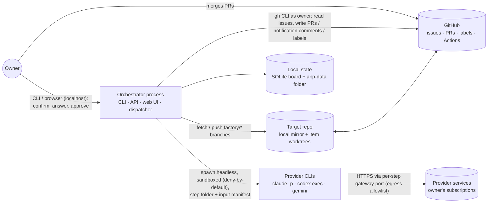
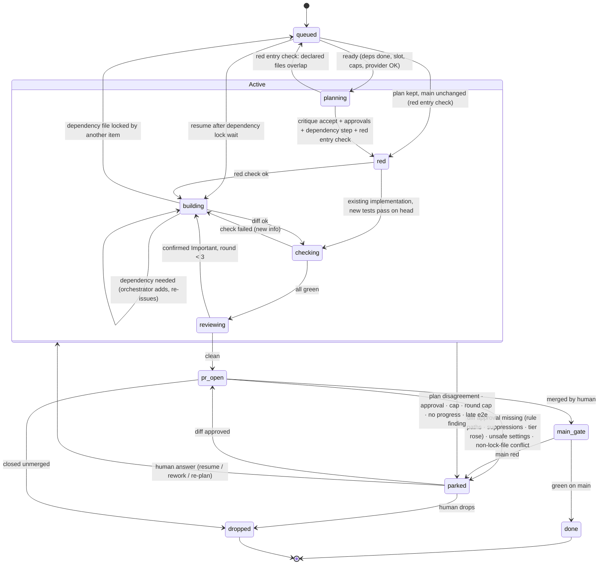

# Software Factory v1 — Architecture

**Status:** proposed, revision 4.1 (2026-11-21). **Inputs:** README, requirements (R1–R13, P1–P20), decisions D-02…D-72 (D-25 replaces D-01; D-63 supersedes D-61; D-64…D-72 are the owner's simplification decisions), values, glossary, facts.
**Scope:** v1 only. Everything deferred is listed once, in §17. The body describes only what v1 builds.
**Vocabulary:** glossary terms are used as defined. New names introduced here are few and each is listed in §2.

Values decide every trade-off below, in their order: (1) verified outcome per token, (2) minimal worker context, (3) simple, (4) safe by structure, (5) observable. When two collided, the section says which won and why.

---

## 1. Context

The factory is one local .NET process on the owner's Mac (the **orchestrator**). It reads a group (a parent issue and its sub-issues) from GitHub, builds a token-free plan, and after the owner confirms the plan it runs **items** through a persistent state machine.

Each model call is a **worker call**: a provider CLI (`claude -p`, `codex exec`, Gemini CLI) started as a headless child process. It runs under the owner's own subscription, inside a Seatbelt sandbox that denies everything by default, against its own disposable folder, with no GitHub credentials. Only the orchestrator talks to GitHub, commits, pushes and opens PRs. A human merges every PR. All state lives outside the target repo, in a SQLite database and an app-data folder.



---

## 2. Entity model (one page)

Nine entities. Everything else is a value inside one of them or a file in the repo (ADR-003).

| # | Entity | Responsibility (one job) | Owned data | Key relations | Glossary terms mapped |
|---|---|---|---|---|---|
| 1 | **Provider** | Says which provider CLI can run here, under which login, and how much of its quota is left | name, CLI path/version, credential file/token location, declared instruction files, egress hosts, usage window limit and observed usage, status `ok/cooling/unsupported` | used by agent profiles in Role | Agent profile = value `(provider, model, effort)` |
| 2 | **Role** | Defines one job an agent may do and what it may touch | purpose, instructions (Markdown), profile allowlist + default, count (finding verifier only), lenses (critic, incl. `plan`), capability preset (which also fixes the workspace), allowed paths, timeout, output schema | Steps run a Role | Role, Planner, Test author, Builder, Critic (lanes = lenses), Finding verifier |
| 3 | **Run** | Carries out one confirmed plan | scope (group / milestone), kind `normal/dry`, trigger `manual`, base commit, config snapshot hash, **plan** (items, order, roles, allowed profiles per role, gates, caps, estimate), plan id, state | 1→* Items; references Groups | Plan (of a run), Factory run, dry run, kill switch |
| 4 | **Group** | Takes one parent issue (= one OpenSpec change) to "done" | parent issue, OpenSpec change name, best ratchet values on main during the group, closing PR and retrospective PR numbers, state | 1→* Items | Group/feature |
| 5 | **Item** | Takes one sub-issue from queue to merged | issue, state + resume state, **item plan** (design options + recommendation, declared files, declared dependencies, red tests + red test ids, e2e decision, risk tier, complexity, requirement refs), branch, worktree head SHA, review round, PR number, merge SHA | belongs to Run and Group; blocked by Items; 1→* Steps, Questions, Findings | Item, Station (= item worktree + its Steps), Risk tier, Light mode, Loop |
| 6 | **Step** | Records one idempotent unit of work: a worker call or a deterministic check | kind `worker/check`, role or check name, agent profile, **input manifest**, typed output, usage (each field measured or not), gateway traffic, failure class, duration, step folder, commit made | belongs to Item (or Group); caps are computed from Steps | Input manifest, Gate (check Steps), Telemetry, worker call, Budget (caps over Steps) |
| 7 | **Question** | Records one decision with discrete options, made by verifier majority or by a human | kind `verify/escalation` (escalation includes approvals and plan disagreements), subject, options, addressee `verifiers/human`, tally, outcome, decided-by, bound SHA/hash, mirror comment id | about an Item, Group or Finding; votes and answers are Board entries | Escalation, approval |
| 8 | **Finding** | Records one claimed defect in a plan or a diff and what happened to it | lens, file/lines, claim, evidence, critic tag `Important/Nit/Pre-existing`, verify result (Important only), outcome `fixed/wrong/intentional/doesn't-matter` (telemetry), round | belongs to Item; Important diff findings verified by a `verify` Question | Critic finding, review ledger |
| 9 | **Board entry** | The append-only record of everything that happened | seq, time, run/group/item/thread ids, type, actor kind `orchestrator/worker/human/github`, actor, addressed role, payload | references any entity; never updated or deleted | Board, Journal (measurement entries), Ratchet (baseline vs measured), audit log |

**Not entities:** human-reviewed files in the target repo (factory config, role files, constitution, ratchet baselines, OpenSpec change and specs, ADRs), and machine-local files (machine config with the provider registry and slots, transcripts, step folders, caches).
**Value objects:** agent profile, input manifest, item plan, checklist, measurement, refusal, cap.
**Glossary terms that are components, not entities:** Orchestrator (§3), Station (§5), Gate (§15), Factory (the whole system). Glossary terms with no v1 counterpart (Council, Judge/moderator, Holdout scenarios, Dark mode): §17.

---

## 3. Components (.NET solution)

Three .NET projects and one web app. Each split is there for one reason; nothing else gets its own project.

| Project | Responsibility | Why it is separate |
|---|---|---|
| `Factory.Station` | The safety boundary. Creates and removes step folders; builds the Seatbelt profile and the empty environment; spawns, tracks and kills worker processes; runs the per-step **worker gateway** (egress allowlist); computes and checks diffs; contains the three **provider adapters** | Value 4. It is the only code that may start a worker process or touch a step folder, so it can be reviewed and adversarially tested on its own. It depends on nothing else in the solution |
| `Factory.Core` | The orchestrator logic. Domain types and the item/group/run state machines as pure transition tables; dispatcher; plan critique and review pipeline; dependency step; gate runner (runs checks through Station); caps; plan builder and estimator; and the IO adapters: SQLite store + board, GitHub adapter (`gh`), git (mirror, worktrees), spec adapter (OpenSpec, including the deterministic archive) | One place for all orchestration rules. An architecture test keeps the `Domain` namespace free of IO, so transitions, caps, risk tier and overlap rules can be unit-tested |
| `Factory.Host` | The single executable `factory`. Spectre.Console.Cli commands (incl. the live terminal views); ASP.NET Core minimal API; serves the built React app; `serve` hosts the dispatcher | The entry point and presentation layer. CLI and UI are both clients of the same API (D-31, D-59, ADR-001) |
| `web/` (React) | Five screens (§14). Built to static files embedded in Host | Required stack (D-34) |

Dependency direction (no cycles): `Host → Core → Station`; `web → Host API (HTTP)`.

Test projects:
- `Factory.Core.Tests`, including the **OpenSpec archive fixtures** (ADDED/MODIFIED/REMOVED/RENAMED deltas) and the suppression patterns (§5).
- `Factory.Station.Tests`, including **hostile-worker tests**. A fake CLI tries each of these, and every attempt must fail:
  - push; reach github.com;
  - read `~/.ssh`, `~/.zshrc`, the Keychain, a concurrent Step's folder, or the provider credential file from a check Step;
  - write protected or rule paths, or lock files;
  - plant global instructions, a settings hook or an MCP entry for the next Step;
  - write `CLAUDE.md`/`AGENTS.md`/`.mcp.json` so that the critic of the same item sees it;
  - escape through IPC: `launchctl submit`/`bootstrap`, `open -a Terminal`, `osascript`, `kill <orchestrator pid>`, `ps eww <orchestrator pid>`;
  - from a check Step, connect to another Step's gateway port;
  - from a restore Step, write to the shared caches;
  - survive kill via `nohup`/`setsid`.
- `Factory.Host.Tests`: CLI JSON contract via Spectre.Console.Testing; API via `WebApplicationFactory`, including CSRF/Origin tests.

---

## 4. Provider adapter contract

The orchestrator owns the process: spawning, sandboxing, timeout, kill and accounting. An adapter does only the mapping: request → command line, and process output → typed result (ADR-004).

**Request (what goes in):**

| Field | Meaning |
|---|---|
| `step_id` | Idempotency key; also used as the step folder name and the commit trailer |
| `role`, `profile` | Role name; `(provider, model, effort)`. The profile is always one of those the confirmed plan lists for the role (D-58) |
| `workspace` | Derived from the role's preset: `read` (planner, critic, verifier) or `write` (builder, test author), following D-53. A full copy of the item head without factory config and agent-instruction files (§5), read on demand |
| `manifest` | Exact list of inputs (D-30): `{kind, ref, hash, bytes, path}` entries, written to `io/in/`. Kinds: `instructions` (role instructions **and** constitution, always from the run's config snapshot, D-27), `spec-slice`, `item-plan`, `diff`, `gate-results`, `checklist`, `failure-report`, `issue`, `owner-answer`, `dependency-added`. The workspace is one entry `workspace@sha` |
| `prompt` | Task text rendered from templates; it names the decision or artifact the call advances (value 1) |
| `output_schema` | JSON Schema id for the role's typed output, written to `io/out/result.json` |
| `capabilities` | Resolved preset (§5). The Station enforces it; the adapter only adds the CLI's own tool/permission flags as an extra layer |
| `limits` | Wall-clock timeout; token cap where the CLI supports one |

**Result (what comes out):** `status ok/failed`, `failure_class`, `output` (validated against `output_schema`), `usage {input_tokens, output_tokens, cost_usd_equivalent}` (each field a value or `null` + reason, never 0 by default), `gateway {hosts, connections, bytes}` (always measured, telemetry), `duration`, `provider_session_id`, `transcript_path` (kept in state, never given to another worker), `reads` (when the CLI reports them; otherwise `not measured`).

**Common output envelope** for every role: `{schema, status: done | blocked | needs_context, needs_context: [{kind, ref, why}], blocked: {reason, …}, notes}` plus the role payload. Role payloads:
- planner → `ItemPlan` (incl. `design: [{question, options[{id, text, trade-offs}], recommended, rationale}]`) or `RetroProposal`;
- critic with `plan` lens → `PlanReview {verdict: accept | revise, findings[]}`;
- critic → `Findings[]`, each tagged `Important / Nit / Pre-existing` by the critic;
- verifier → `Verdicts[{finding_id, real, rationale}]`;
- test author → `TestReport` (+ file changes);
- builder → `BuildReport {notes, disputed[{finding_id, reason}]}` (+ file changes).

**One context mechanism (v1): `needs_context`.** A step that needs more context ends with `status: needs_context`. Its file edits are **discarded**. The orchestrator fetches what was asked for, logs a `context.fetched` board entry and re-issues the step with the larger manifest, which is the new information. No live MCP tool in v1.

**Dependencies are not context** (D-65). A builder that needs a direct dependency the plan did not declare ends with `status: blocked, blocked: {reason: dependency, id, version, why}`. Its edits are discarded (C4). The orchestrator runs the dependency step (§5), asking the owner only for a package that is not on the constitution's allowlist, then re-issues the builder with `dependency-added` in the manifest.

**Failure classes and the fixed reaction to each** (value 1: retry only with new information):

| Class | Detected by | Reaction |
|---|---|---|
| `timeout` | orchestrator timer | kill (§5); no automatic retry, escalate (options: retry with a larger limit / rework / drop) |
| `rate_limited` / `quota` | adapter pattern on the output content (below) | provider → `cooling` (backoff); switch to another profile **listed in the plan for this role** if the diversity rules still hold (P7, D-58); otherwise wait |
| `provider_unavailable` | probe / exit code | provider → `unsupported` until `doctor` passes; the item waits or switches within the plan's profiles |
| `invalid_output` | schema validation, or a missing/non-JSON `io/out/result.json` | one retry with the validation errors as new information; then escalate |
| `policy_violation` | sandbox denial or diff check (§5) | changes discarded; one retry with the violation report; then escalate |
| `crashed` | non-zero exit without a class | re-probe the provider; retry once **only if the probe shows a change** (version, login, status); otherwise escalate |
| `cancelled` | kill switch / stop | the Step is re-issued on resume |

**Classification reads content, not the exit code** (spike E12, [findings §5](../spike/findings.md#5-failure-patterns-e12-and-the-adr-004-closed-list)). All three CLIs exit 0 for `invalid_output` and for `policy_violation`: a sandbox denial shows only as tool-result text or item status (claude: `EPERM` text; codex: `command_execution` / `file_change` with status `failed`; `agy`: `operation not permitted` in a tool result with `status: SUCCESS`), and invalid output as a missing `structured_output` or result file. None of them has an auth class: a 401 or an expired credential must be caught by `provider probe` before the Step. A real quota 429 could not be forced for any CLI, so quota and burst are told apart only where the output says so (codex `usage_limit_reached` vs `rate_limit_exceeded`; claude's `rate_limit_event` carries quota data, but the findings did not show how a quota refusal differs from a burst one). The orchestrator's own timer bounds anything that retries silently: `agy` retries 429/500/503 for more than 100 s and ignores SIGALRM, so the timer sends SIGTERM (it then answers with a structured `interrupted` result) and SIGKILL after 10 s. codex falls back **silently** from an unsupported effort to `medium`, so the adapter validates effort against the model list. Two class assignments are left to the owner (proposed D-81): claude's 529 after exhausted retries, and codex's dead-gateway-port exit.

**Fit per provider, as observed in the spike** (claude 2.1.330, codex-cli 0.171.0, Antigravity `agy` 1.5.14; full commands, flags and logs in [findings §4](../spike/findings.md#4-per-cli) and §8). The CLI versions are those of the spike; pinning a version per adapter and re-running the probes on a change are not decided here (D-79 proposes re-running the E8 control). The third column is the CLI that was tested for the gemini slot; the Gemini CLI itself was not exercised, and whether `agy` takes the slot (and its provider id) is proposed in D-78.

| | `claude -p` | `codex exec` | Gemini slot: Antigravity `agy` |
|---|---|---|---|
| Headless mode | `-p`, prompt on stdin | `codex exec`, prompt on stdin | `agy`, prompt on stdin **without** `-p` (`-p` takes the prompt as its value; empty stdin without `-p` starts the TUI and exits 0) |
| Typed output | `--output-format json`; `--json-schema` → `structured_output`; a worker-written `io/out/result.json` also works, without a shell | `--json` JSONL events; `--output-schema` + `-o` needs a strict-mode schema; a worker-written file works, without a shell (`apply_patch`) | `--output-format json`; `--json-schema` through a `finish` tool, schema reaches the model lossily; a worker-written file works through `write_file`, without a shell. The result file stays the contract (D-81, proposed) |
| Model / effort | `--model` alias, `--effort low…max` | `-m`, `-c model_reasoning_effort=…`; an unsupported value falls back silently | `--model`, `--effort low…max` (validated by the CLI). **Effort is supported**, so diversity can also come from effort |
| Usage | tokens in `usage`; `total_cost_usd` is the **list price**, not what a subscription is billed; quota only in `stream-json --verbose` (`rate_limit_event`, unit unverified) | tokens in `turn.completed.usage`; cost `null`; quota only in the rollout file (needs a persisted session) | tokens in `usage`; cost `null`; quota by a separate `/quota` call (`remaining_fraction` per window and model group), not in the run's own output |
| Credentials without Keychain | token from `claude setup-token`, by file descriptor 3 (a pipe; keeps it out of argv and environment) or `CLAUDE_CODE_OAUTH_TOKEN`; no credential file was used (a `.credentials.json` mechanism exists in the binary, untested) | file `$CODEX_HOME/auth.json`; the Step copy carries a dummy `refresh_token` (open: D-75) | file `…/antigravity-cli/antigravity-oauth-token`, used when `security` is unavailable; the owner's own login is Keychain-only. Refreshes in memory per call from a read-only copy |
| Session/config location → step `home/` | `CLAUDE_CONFIG_DIR`, `CLAUDE_CODE_TMPDIR` | `CODEX_HOME` (empty: pass model and effort explicitly) | `HOME` (`.gemini/` and `Library/Application Support/antigravity/`) |
| Declared instruction/settings files (excluded and protected, §5) | `CLAUDE.md`, `CLAUDE.local.md`, `.claude/**`, `.mcp.json` at any depth; in `home/`: `CLAUDE.md`, `settings.json`, `.claude.json` (list **not shown complete**, Q3) | `AGENTS.md`, `AGENTS.override.md`, `.codex/**`, `.agents/**`, `.mcp.json` at any depth; in `home/.codex/`: `config.toml`, `AGENTS*.md`, `skills/**`, `rules/**`, `hooks.json`, `*.config.toml` | `AGENTS.md`, `GEMINI.md`, `.agents/**`, `.gemini/**` at any depth (hooks and MCP configs **execute code**); in `home/.gemini/`: `GEMINI.md`, `AGENTS.md`, `settings.json`, `skills/**`, `antigravity-cli/{settings.json,hooks.json}`, `config/**`, and `Library/Application Support/antigravity/` |
| Ignore project instruction files | flag `--setting-sources ""` (second layer) | flags for repo `AGENTS*.md`, skills, user config and rules; none for global files in `CODEX_HOME` (so `home/` stays empty) | **none**: exclusion from the copy and an adapter-owned empty `home/` only |
| Mach services needed | none | `com.apple.system.opendirectoryd.libinfo` + mandatory `CODEX_CA_CERTIFICATE` (D-76, proposed) | `com.apple.trustd.agent` + non-Mach rules (§5) |
| Own sandbox | off: `--settings '{"sandbox":{"enabled":false}}'` pinned (with `enabled:true` a failed sandbox start degrades silently to an unsandboxed tool) | off: `-s danger-full-access` + `approval_policy="never"` (on, the shell tool fails inside our profile) | off by default; pin `enableTerminalSandbox:false`; never `--sandbox` or `--mode auto` |

**Remaining uncertainties:** claude's declared-file list (E8 `open`, D-79 proposed); credential lifetime and refresh for claude and codex (Q2); whether quota units match the providers' usage pages (Q5); the third column rests on D-78. The safety design does not depend on any CLI feature: the result file, the sandbox, the gateway and the diff check work for any CLI that can read a prompt and write a file; a CLI that cannot work this way is `unsupported`. All three tested CLIs end the spike `supported (conditional)`: the conditions are adapter and `doctor` requirements, listed in [findings §2](../spike/findings.md#2-verdicts).

---

## 5. Station and sandbox

The **Station** for an item is (a) the orchestrator-owned **item worktree** on branch `factory/<issue>-<slug>`, which workers never see, plus (b) one **step folder per Step**. There is one isolation mode: **same OS user + deny-by-default Seatbelt** (D-56, D-63, ADR-005).

**Step folder lifecycle:** `work/<step-id>/`, mode 0700.
1. Create `home/` (**adapter-owned and otherwise empty**: every provider config/session location variable points here, and a CLI's global instruction, hook or MCP files in `home/` are read or executed, so nothing is planted there; E8), `io/in/` (manifest), `io/out/`, `tmp/`, and the credential (one file or token for this provider only, read-only). Measured mechanisms (spike): claude, a token from `claude setup-token` delivered on file descriptor 3, so it is out of argv and the environment (the environment variable is the fallback; a regular-file descriptor does not authenticate under `sandbox-exec`, a pipe does); codex, a 0400 copy of `auth.json` with a dummy `refresh_token`; `agy`, a read-only copy of its token file. A read-only copy prevents modification, not reading: a worker with a shell reads it (S1). Where the credential comes from (`factory auth`) is proposed in D-75; whether a Step copy carries a dummy refresh token is left open there.
2. `repo/` = APFS clone (`clonefile`) of the item worktree head, **without `.git`, `.factory/**` and agent-instruction files**. The excluded instruction files are the built-in list (`CLAUDE.md`, `AGENTS.md`, `GEMINI.md`, `.claude/**`, `.codex/**`, `.gemini/**`, `.cursor/**`, `.github/copilot-instructions.md`) ∪ every provider adapter's declared list (measured in the spike; claude's list is not shown complete, Q3. Names added to the built-in list: `CLAUDE.local.md` and `.mcp.json` (claude), `AGENTS.override.md` (codex), `.agents/**` (codex, `agy`); per-CLI lists in §4 and [findings §4](../spike/findings.md#4-per-cli)), at any depth and **matched case-insensitively** (APFS). The declared lists are the control and a CLI's ignore flag a second layer (proposed in D-79; plan E8 already requires exclusion from the copy). D-27: rules reach workers only through the manifest. A fresh local git repo with no remotes is created inside it for agents' convenience.
3. Record the tree manifest of `repo/` (path → hash, mode, symlink target), **excluding `repo/.git`**.
4. Run the worker (below). On exit, timeout or kill: confirm that no tracked process of the Step remains (kill them otherwise), close the Step's gateway port, then APFS-clone `repo/` to `snapshot/`. All later work reads the snapshot, so a late write cannot race the hash.
5. Compute the diff from `snapshot/` against the tree manifest. Ignored files are discarded using the **base commit's** ignore rules, not the copy's, so `bin/`, `obj/` and `node_modules/` never count. Edits of a Step that ended with `needs_context`, `blocked` or a failure are discarded: the Step folder is **deleted and rebuilt** (fresh `home/`), never reset by running `git` inside it (E9: a worker-touched copy and a transcript in `home/` are not trusted).
6. Run the diff check. If it passes, the orchestrator applies the files to the item worktree and commits with trailers `Factory-Step: <id>` and `Factory-Role: <role>`. Then it deletes the step folder.

**Isolation layers:** layers 1–3 and the diff check are structural; layer 4 is an extra.
1. **Seatbelt profile per Step, true `(deny default)`.** Everything not listed is denied:
   - **File reads:** system paths (`/System`, `/usr`, `/bin`, `/Library/…` as needed), curated toolchain directories (dotnet, node, provider CLI install), the **shared caches** and the item's package overlay (both read-only), the Step's own `work/<step-id>/`, and its credential.
   - **File writes:** `repo/` (only with workspace `write`), `io/out/`, `home/`, `tmp/`; for the restore Step, the item's package overlay only.
   - **Mach:** `mach-lookup` only for an allowlist of services that each CLI, `dotnet` and `node` actually need. **Measured** (E3, S5): claude none; codex `com.apple.system.opendirectoryd.libinfo` (D-76, proposed) plus a read rule for `/private/etc/ssl/cert.pem` and `/etc/codex/requirements.toml`; `agy` `com.apple.trustd.agent` plus non-Mach rules (read `/etc/hosts`; loopback `network-inbound`, see Network; builder: exec of `/bin/zsh` and the pseudo-terminal device rule, Q11); codex builder: exec of `/bin/zsh` and a read rule for the `/bin/sh` trampoline; `dotnet` and `node`: none. The allowlist is per provider (as §5 already said), so a service applies to every process of that provider's Step. The allowlist **excludes**:
     - launchd job submission;
     - LaunchServices (`open`);
     - Apple Events (`appleevent-send` denied);
     - Keychain/security services;
     - pasteboard.

     `mach-register`, `iokit-open` and `ipc-posix` are denied unless the spike shows they are needed.
   - **Processes:** `process-exec` only from the preset's allowlist (below); `signal` and `process-info*` only for the Step's own process group. Workers cannot signal or inspect the orchestrator or any other owner process. **Measured (S2):** with the spike's `base.sb`, exec, signals, `launchctl`, `open` and `security` are denied (`osascript` too for the fake CLI; with real codex and `agy` the evidence is weak), but any worker can read the argv and environment of every same-owner process (`sysctl KERN_PROCARGS2`), including a token passed in an environment variable, so S2 **fails** with that profile. A **candidate rule**, not adopted and still an owner question ([findings §9 (g)](../spike/findings.md#9-for-the-owner)), is `(deny process-info*)` plus `(allow process-info-pidinfo (target self))`. It narrows "own process group" to "self", denies every other `process-info` operation on self, was verified with the fake CLI only, and claude runs its tool shell in its own process group; it must be re-run with each real CLI before §5 can say it holds (Q3).
   - **Network:** worker Steps → only `localhost:<the Step's own gateway port>`. Check Steps → only the localhost ports of their own services (Azurite, the app under test); the restore Step → its own gateway port. **Measured (S3):** the profile can only scope an address as `localhost:<port>` (Seatbelt rejects a literal IP: `host must be * or localhost`), and that form also matched the LAN address and `::1` on the connect side. So gateways bind `127.0.0.1` only and configuration values (proxy and service URLs) use literal IPs, because the name `localhost` does not resolve inside the sandbox. A worker cannot listen on loopback under this profile. `agy`'s loopback listen rule can only be written as `localhost:*` too; whether it also lets a listening worker be reached from the LAN address was **not measured** (inferred from the connect-side finding; Q11). `agy` (its in-process language server) needs a loopback listen rule, which lets a worker squat a port that is later handed to another Step's gateway (Q11, D-80 proposed). `dotnet test` (VSTest) needs loopback bind **and connect** on any port, whose connect half also reaches other Steps' gateway ports (S5); D-80 proposes not accepting it for builder Steps.

   As a result (once the process-info rule above is fixed), the owner's home, other Steps' folders, factory state and the owner's Keychain cannot be read, and no route starts code outside the sandbox.
2. **Empty environment + allowlist:** `PATH` (curated), `HOME=<step>/home`, provider config-location variables → `<step>/home`, `TMPDIR`, `LANG`, `TERM=dumb`, cache locations (`NUGET_PACKAGES` read-only fallback folder, npm cache, `PLAYWRIGHT_BROWSERS_PATH`), `HTTPS_PROXY`/`HTTP_PROXY` = the Step's gateway port, `FACTORY_STEP`. Nothing else: no `GH_TOKEN`, `GITHUB_TOKEN`, `SSH_AUTH_SOCK` or cloud variables, and no tokens in the environment except a provider token where that is the CLI's credential mechanism. Per-CLI additions (measured): claude `CLAUDE_CONFIG_DIR`, `CLAUDE_CODE_TMPDIR` (otherwise it creates `/tmp/claude-<uid>`) and `CLAUDE_CODE_DISABLE_NONESSENTIAL_TRAFFIC=1`, `DISABLE_TELEMETRY=1`, `DISABLE_ERROR_REPORTING=1`, `DISABLE_AUTOUPDATER=1`; codex `CODEX_HOME`, `CODEX_CA_CERTIFICATE`. `agy` does not strip its own environment from its tool shell (it shows its CSRF token and language-server address), so nothing else may be set for it.
3. **Worker gateway, one localhost port per Step**, opened at spawn and closed at the Step's end. Each port serves only its own Step, because the Seatbelt network rule lets no other Step reach it.
   - A CONNECT proxy whose allowlist depends on the Step: worker Steps get their provider's API hosts plus the role's web allowlist; the **restore** Step gets the package registries only. Other check Steps have **no gateway** and no provider hosts. Measured provider hosts, **with the CLI's hygiene switches set** (without them extra telemetry and asset hosts appear): claude `api.anthropic.com`; codex `chatgpt.com` (`--disable plugins/remote_plugin/apps`, `analytics.enabled=false`; the probe adds `auth.openai.com`); `agy` `daily-cloudcode-pa.googleapis.com`, `aicode.googleapis.com`, `www.googleapis.com` (an eligibility check; blocking it fails the call), `oauth2.googleapis.com`.
   - Every host, connection and byte count is logged to the Step as telemetry (§10, D-66).

   Because the port closes when the Step ends, a process that escaped the kill cannot use the network afterwards.
4. **CLI tool/permission flags** from the preset, plus each CLI's flag to ignore project instruction and settings files where one exists. The CLIs' own Seatbelt sandboxes are turned off, because they cannot nest. The flag is pinned per CLI (§4): claude `sandbox.enabled=false` (`true` degrades silently to an unsandboxed tool), codex `-s danger-full-access` with `approval_policy="never"`, `agy` `enableTerminalSandbox:false` and never `--sandbox`. Each CLI also declares tools to the model that reach beyond the repo: codex `web__run` and `multi_agent_v1__*` (the flags `--disable multi_agent` and `-c web_search="disabled"` are accepted, but their effect on the tool list was not verified); `agy` `search_web`, `invoke_subagent`, `swarm`, `schedule` (no flag found). Hosted tools (web search) run at the provider, behind an allowed provider host, so the gateway allowlist does **not** bound what they fetch; only turning them off would, and no flag is verified to do that.

**Process tracking and kill:** same user, so the orchestrator can always signal its workers. The reverse is blocked by Seatbelt, because workers may signal only their own process group. Each Step is spawned in its own process group with marker `FACTORY_STEP=<id>`. Station records the Step's descendant PIDs every second. Kill = SIGTERM to the group and the recorded PIDs, then SIGKILL after 10 s, then a scan for any process carrying the marker. **Measured (E11, all three CLIs):** the tracked set misses a `setsid` double fork; the marker scan finds it; the kill must cover the tool shell's process group and the CLI's helper group (codex `codex-code-mode-host`) as well as the CLI's own. The "no network afterwards" property holds only if a gateway port number is **never reused** while a survivor can exist; a survivor with no network was seen for codex and `agy`, and the evidence for claude is weak. Hostile-worker tests cover `nohup`/`setsid`. Residual risk: Q4.

**Capability presets (D-17, D-71).** The preset is the single knob: it fixes the workspace and is enforced by the Seatbelt exec and write rules and by the gateway.

| Preset | Roles | Workspace (derived) | Writes | Exec allowed (Seatbelt `process-exec`) | Network (gateway) |
|---|---|---|---|---|---|
| `reviewer-readonly` | planner, critic, finding verifier | read | `io/out` | CLI binaries + read-only helpers it bundles (e.g. ripgrep); no shell | provider API |
| `builder` | builder, test author (allowed paths: test globs) | write | `repo`, `io/out` | shell and toolchain (offline; caches and overlay read-only) | provider API |

- **Proposed, not accepted (D-77):** `reviewer-readonly` gets a shell under a no-write profile with `process-exec` limited to `zsh`, `cat`, `rg`, `ls`, `head`, `git`, replacing "no shell". Spike evidence (E10): without a shell codex cannot read `repo/` at all (no file-read tool) and `agy` reads only files it is told about (no list or search tool); claude has a Read tool. The wording is conditional on a check with real codex and `agy` that the spike did not run.
- **Measured (S4, S5), not yet a rule:** under the builder profile `repo/` is writable, so lock files, instruction files and symlinks planted there are caught by the diff check, not by Seatbelt. The builder's exec list does not include coreutils or `git` (`cat` and `git` were denied at exec). `dotnet restore` needs `/tmp/.dotnet` (a host-wide directory shared with the owner's dotnet), and `dotnet test` (VSTest) needs a loopback bind and connect rule, which conflicts with the network rule above (Q11, D-80 proposed). `dotnet build/test` and `npm ci/test` otherwise ran offline against read-only caches with no extra Mach service.
- The test author uses the builder's offline toolchain to compile and run its tests (D-71). Its writes are limited to test globs by the diff check, the copy is discarded, it has no credentials, and the orchestrator's red check runs independently, so the value-4 test still holds. Value 3 won over D-17's "run only the repo's tests" exec limit; the collision is recorded in D-71.
- **"Push branches":** workers never push (D-26). The switch means "the orchestrator may push this role's commits to `factory/*`". Protected branches and merges are never allowed.
- **"Web access (allowlist)":** the gateway allowlist; Seatbelt blocks direct egress.

**Builds and dependencies (D-62 as amended by D-65):**
- **Shared caches** live in `caches/` (NuGet fallback folder, npm cache, Playwright browsers, Azurite install). They are filled **only from main, by the orchestrator**: `doctor --prepare`, and after a green `main_gate` (which restores into a clean per-run folder first). Every Step sees them read-only.
- **Item package overlay** `items/<issue>/packages/`. The item's **restore** Step is the only Step with registry egress. It writes only into this overlay, with the shared cache as a read-only fallback. It runs `dotnet restore --locked-mode` and `npm ci --ignore-scripts` (integrity hashes from the lock files). One item's restore therefore cannot change another item's or main's packages.
- **Dependency step** (orchestrator, no model; the only place new direct dependencies enter):
  1. Approval first: the package is on the constitution's allowlist, or the owner approves it (with the plan, or in an Inbox Question while the item is parked).
  2. **File lock (K3):** the project file or `package.json` that receives the reference is added to the item's declared files and declared-file lock, in one transaction, as in the red entry check. If another unmerged item holds that file, the item goes to `queued` with resume state `building`, keeping its plan, tests and commits. A `refusal` names the holder, and the item resumes at the dependency step when the lock is free.
  3. The orchestrator writes the reference (`PackageReference` / `package.json` dependency) and regenerates the lock files (`packages.lock.json`, `package-lock.json`) in a restore Step with registry egress (`--ignore-scripts`). It commits them as an orchestrator commit on the item branch.
  4. A locked restore into the overlay.

  It runs (a) for the plan's declared dependencies, after plan approval and before `red`, and (b) inside `building` when the builder needs a dependency (`blocked: dependency`, or an undeclared dependency in its diff, rule 3), after which the builder is re-issued. There is no return to `planning`.

  **Lock files are derived and orchestrator-owned.** They are not part of the file lock, because every dependency change touches them. When merging main into an item branch conflicts only in lock files, the orchestrator regenerates them from the merged references (step 3), commits them, and re-runs the checks; it never parks for this.
- The builder and all checks run offline against cache + overlay. `checking` does not restore.
- `doctor` runs every check under the real profile.

**Diff check,** run after every worker Step. The first failing rule refuses the change, and the board entry names that rule:
1. **Protected paths** (all roles, built in): `.factory/**` (config, roles, constitution, ratchet baselines), `openspec/**`, `docs/adr/**`, **lock files** (`packages.lock.json`, `package-lock.json`), and **agent-instruction files** (built-in list ∪ adapters' declared lists, as in step 2). Workers never change these. Only orchestrator-authored commits do: ADRs, lock files, ratchet at group close, OpenSpec archive, retrospective proposals. Humans change them through their own PRs.
2. **Role allowed paths** (from the role file; `reviewer-readonly` cannot write `repo/` at all).
3. **Declared files and new dependencies** (D-38, D-65): any changed path outside the declared files is refused. A new direct dependency in a worker's diff also refuses the **whole** diff; nothing is ever partially applied (K2). The orchestrator records the dependency as a request and takes the same path as `blocked: dependency`: it runs the dependency step, then re-issues the builder with `dependency-added` and the note that its previous edits were discarded.
4. **Red-test lock:** for the builder, any change to a file the test author created or changed is refused (replaces dw's hash lock, D-32). The red check also records the **red test ids**, and `checking` fails if any of them did not run and pass.
5. **Rule paths and new suppressions** (they need a **human approval of the diff, bound to its SHA, before it is pushed**; §6 `pr_open`; D-50, D-22):
   - `.github/**` (D-50);
   - gate-defining paths:
     - `Directory.Build.props/.targets`, `Directory.Packages.props`, `global.json`, `*.sln`/`*.slnx`;
     - `.editorconfig`, `.globalconfig`, `*.ruleset`, `GlobalSuppressions.cs`;
     - ESLint, Prettier, Playwright, Vitest/Jest configs, `tsconfig*.json`, `*.runsettings`;
     - the `scripts` key of any `package.json`;
     - rule-weakening elements in project files: `NoWarn`, `TreatWarningsAsErrors`, `WarningsAsErrors`, `RunAnalyzers`, `EnableNETAnalyzers`, `AnalysisLevel`, `EnforceCodeStyleInBuild`, `Nullable`, `<Compile Remove>`, and removal of an analyzer `PackageReference`;
     - the constraint-tests folder named in the constitution.
   - **New suppressions in the item diff:** any added line matching `#pragma warning disable`, `SuppressMessage`, `#nullable disable`, an `<auto-generated` header, `eslint-disable` in any comment form (`//`, `/* */`), `@ts-ignore`, `@ts-expect-error` or `@ts-nocheck` (C2, A5).

   Rule-path changes are allowed only if declared in the plan, and they make the item high risk.
6. **Sensitive paths** (configured globs, dependency manifests): allowed if declared; they make the item high risk (§8).
7. **Hygiene:** no symlinks that point outside the copy, no executable-bit changes outside allowed paths, size limit per file.

**No local users (D-63):** the factory never creates macOS users and has no other isolation mode in v1. If the spike or `doctor` shows that the sandbox cannot hold for a CLI (no Keychain-free credential, or Mach services that cannot be narrowed), that provider is `unsupported`. The factory runs with the remaining providers; profiles of an unsupported provider are rejected by `config validate` and the plan.

**`sandbox-exec` status (S6, macOS 27.2.1):** the tool is present, signed by Apple, and `man` marks it deprecated; it prints no runtime warning. Deny-default, read, write and network denial behave as described above; a nested sandbox is denied under a deny-default profile (which is why the CLIs' own sandboxes stay off). Built-in profiles (`-n`) are killed (exit 137), so the Station always passes its own profile file (`-f`). No older macOS release was available, so "changed since the previous release" is not measured; `doctor` re-runs the hostile-worker probes after every macOS update (Q3).

---

## 6. Item state machine (P5, D-48)

Eleven states. State is stored in `items.state`. A transition and its board entry are written in one SQLite transaction. Every Step is idempotent: a step folder has no effect until the orchestrator applies and commits it.

| State | Work (Steps) | Acting role | Exit decided by | Success → | Failure / limit → |
|---|---|---|---|---|---|
| `queued` | wait | dispatcher | dependencies `done`; free slot; run caps not reached; provider below threshold; for resume state `building`, the dependency's file lock is free | `planning`; or the red entry check if a plan exists and main has not moved since it; or `building` (resume after a dependency lock wait, K3) | stays (refusal entry names the reason) |
| `planning` | (1) planner drafts the plan, or revises it with critique findings: approach, **design options with a recommendation**, declared files, declared dependencies, red tests (incl. boundary and negative-path tests, D-67), e2e decision; (2) one **plan critique** (critic, `plan` lens, read-only, profile ≠ planner's): checks all of these, including every `e2e: not-applicable` and each design recommendation (D-51, D-52, D-64) | planner, critic | critique `accept` → approvals → dependency step → **red entry check**; `revise` → one revision, then critique again | `red`, or `parked` (approval) | second `revise` → `parked`; the owner decides the disagreement (D-64) |
| `red` | test author writes failing tests: ≥1 E2E per acceptance scenario when `e2e: required` (D-45), plus boundary and negative-path tests per requirement (D-67); compiles and runs them with the offline toolchain; then the **red check** | test author | **No implementation yet:** new tests fail on the item head (compile errors only inside new test files count as red); existing tests pass. **Item already has non-test commits** (re-plan, run adoption; K4): if the red tests are unchanged since the recorded red evidence, that evidence is kept and no test-author call is made; otherwise new or changed tests must fail on the **base commit + those tests**, and existing tests pass on head. Red test ids recorded | `building`; with an existing implementation and all new tests passing on head → `checking`; red-test files locked | retry once with the report; then `parked` |
| `building` | builder implements or fixes; on `blocked: dependency` or an undeclared dependency in the diff, the orchestrator runs the dependency step and re-issues the builder (D-65) | builder | diff check | `checking` | `policy_violation` retry once, then `parked`; non-allowlisted dependency → `parked` (owner Question), then back to `building`; dependency file held by another item → `queued` (resume state `building`) |
| `checking` | deterministic gate (§15), offline | — (check Steps) | all checks pass (not run = fail); red ids ran and passed; ratchet holds | `reviewing` | `building` with the failure report; same failure fingerprint twice → `parked` |
| `reviewing` | critic lanes → deterministic checklist → verifier on `Important` findings only (§8) | critic, finding verifier | no confirmed `Important` finding; no lane or verifier unanswered | `pr_open` | confirmed `Important` → `building` (round + 1); a confirmed finding that `e2e: not-applicable` is wrong → `parked` (options: open the PR with a follow-up issue for the E2E tests / re-plan / accept; D-71); after round 3 → `parked` |
| `pr_open` | **Entry action** (idempotent, hidden markers): re-check the D-50 repository settings (else `parked`); recompute the risk tier on the final diff; a human diff approval bound to the head SHA must exist (else `parked`, one Question) if the diff touches rule paths, adds suppressions, **or the tier rose to high after `red`**, e.g. through a mid-build dependency (S1); push; open PR (body: plan, ADRs, gate results, review ledger, cost); follow-up issues for pre-existing findings; release slot. **While open:** if main moves, merge main into the branch and re-run `checking`'s checks | orchestrator (+ human) | PR merged by a human | `main_gate` | closed unmerged → `dropped`; conflict only in lock files → orchestrator regenerates them (§5); any other conflict → `parked`; GitHub write failing after backoff → `parked` |
| `main_gate` | gate on main at the merge SHA | — (check Steps) | green | `done` | `parked`; group dispatch pauses while main is red |
| `parked` | wait for a human Question; slot released, file lock kept | human | answer (UI or CLI only, D-70) | the state the answer names (resume / rework → `building` / re-plan → `planning` / drop → `dropped`) | — |
| `done`, `dropped` | terminal; both release the file lock | | | | |

**Fixed order into `red`:** `planning → critique accept → approvals → dependency step → red entry check → red`.
- The approvals form **one** Question with the plan, covering whichever apply: high-risk plan approval; owner confirmation if the planner changed `e2e` from `required` to `not-applicable`; declared dependencies not on the constitution's allowlist (D-62, D-65).
- After critique `accept` and any required approval, the orchestrator renders each design decision of the plan as an ADR, `docs/adr/i<issue>-<n>-<slug>.md`, on the item branch (no tokens; D-22, D-64).
- The **red entry check** runs atomically on every entry into `red`: it verifies that the declared files do not overlap a locked item, acquires the lock, and verifies that any required plan approval is bound to the current plan hash and base SHA. Overlap → `queued` (plan kept, slot released); a stale approval → `parked`.

**Slots and locks:** a slot (D-38) is held from `planning` through `reviewing` and released at `pr_open`, `parked` and `queued`. The declared-file lock is held from `red` until `done` or `dropped`, so two unmerged PRs never touch the same files (P10). The merge queue is "human merges in dependency order" plus "a dependent starts only from main after its blockers are `done`" (D-37). The orchestrator writes no shared files on item branches except lock files, which it regenerates on conflict (§5). ADRs are named by item id, project files touched by dependencies join the file lock (K3), and ratchet tightening happens at group close.

**Cap exits:** any active state → `parked` when an item cap refuses the next Step (§10). Wall time excludes `parked` and `pr_open`.

**Resume after crash:**
1. Kill every process carrying a `FACTORY_STEP` marker and close all gateway ports.
2. Mark Steps that have `step.started` but no `step.finished` as `abandoned`; their usage counts at the role estimate (flagged `estimated`); delete their folders.
3. For each item, compare the worktree `HEAD` with the stored `head_sha`. A commit with a `Factory-Step` trailer for an abandoned step is adopted (finished); any other unknown change is reset to `head_sha`.
4. Re-check GitHub writes by their markers before repeating them.
5. The dispatcher re-issues the current state's Step.

No state is ever inferred from the worktree alone.



---

## 7. Group and run lifecycle

**Run** (`planned → running → draining → stopped | done | killed`):
1. **Plan (token-free, D-28):** `factory plan --group <issue> | --milestone <m> [--dry-run]`. The orchestrator:
   - re-checks the D-50 repository settings (exit 3 if they fail);
   - fetches the mirror and reads config **from the base commit** (D-27) into a snapshot;
   - reads issues, sub-issues and "blocked by" links (D-05), and loads the OpenSpec change (D-21);
   - computes the item order (topological); for each role the **allowed profiles** (primary + alternates, diversity-checked per D-10; runtime switches stay inside this list, D-58); gates; caps; a heuristic e2e default per item (`required` unless the item is labelled internal/docs/config; the owner can pin it here, D-44); and an estimate (§16).

   Plan id = hash(base SHA, config snapshot hash, plan body). No model is called.
2. **Confirm:** `factory run confirm <plan-id>` moves `planned → running`. It is a **refusal, not a state**, when main or the config moved since the plan (exit 5, next_action: re-plan) or when the estimate exceeds a run cap (exit 4, the cap is named).
3. **Dispatch:** the dispatcher starts ready items, up to `slots` at once (default 2). Before each worker Step it checks the item and run caps against spent + the Step's estimate (§10).
4. **Config change on main:** a new commit on main that changes `.factory/**` and does **not** come from a factory-authored closing or retrospective PR (`factory/close-*` / `factory/retro-*` branch and marker) moves the run to `draining`, with a notice "config changed; re-plan to continue" (D-27).
5. **Stop / kill:** `run stop` → `draining`. **Draining:** no new Steps start; each running Step finishes its **current Step only**; items stay in their current state; the run becomes `stopped`. Run-cap overrun does the same (D-19). `factory kill` → kills all worker processes (§5), closes all gateway ports and marks runs `killed`; nothing writes to GitHub afterwards.
6. **Resume or re-plan (C3):** `run resume` continues on the same snapshot. A re-plan creates a new run that adopts the unfinished items: items in `pr_open` or `main_gate` continue as they are; all others go back to `planning` with their plan kept as a draft, and the critique and approvals re-run against the new snapshot. Items with an implementation then pass `red` with their recorded red evidence or a base-commit red check (§6, K4). There are no reservations to move (D-66).
7. **Done** when every Group in scope is `done` or the owner closes the run.

**Dry run** (D-38): the same plan; Steps of kind `worker` are recorded as `skipped (dry run)`; gates run on the base commit in real step folders; the GitHub adapter is read-only and logs "would write". `doctor` runs first. Spend is 0 tokens by construction.

**Group** (`new → active → closing → done`, plus `parked`):
- `new` → `active` when a run dispatches its first item.
- `active`: items flow (§6). `main_gate` measurements update the group's **best ratchet values on main** (B4).
- `closing` (all items `done`):
  - (a) Open the **closing PR**, written by the orchestrator. It archives the OpenSpec change **deterministically in the spec adapter** (delta sections merged into `openspec/specs/`, change folder moved to `openspec/changes/archive/<date>-<change>/`). It writes into `.factory/ratchet.yaml` the **effective baseline** for each metric: the stricter of the file's value and the group's best value on main (D-21, D-23).
  - (b) Open the **retrospective PR** (D-37, P9). The planner role, with retrospective instructions, proposes edits to role instructions, the constitution and review notes. Its manifest is the group's journal, review ledger, finding outcomes and escalations. The orchestrator writes the proposed files, because they are protected paths. The PR is high risk and needs a human.
- `done` when the closing PR is merged, the gate on main is green and the retrospective PR is open (D-37 without its holdout part, D-67).
- `parked`: main is red → escalation; dispatch for the group pauses; other groups continue.

**Main gate on foreign commits:** any new commit on main during an active group (e.g. a Dependabot merge, D-23) triggers a main gate run. A red main pauses dispatch.

---

## 8. Plan critique, review pipeline and approvals

**Design decisions without a council** (D-64):
- The planner lists each design question in the plan with discrete options, trade-offs and a recommendation, within the constitution (D-22).
- The plan critique (a critic with the `plan` lens, on a profile that differs from the planner's) checks the recommendation like any other part of the plan.
- If they still disagree after one revision, the item parks and the owner decides in the Inbox. The options and both rationales are the Question's options and evidence.
- Each decision is rendered as an ADR on the item branch (§6).

**Plan critique** (D-51, D-52, R3 as amended by D-64): one read-only critic Step with the `plan` lens on every item plan before `red`.
- Inputs: item plan, spec slice, constitution, issue, read-only workspace.
- Output: `accept`, or `revise` with findings (stored as Findings, lens `plan`, not verified).
- It checks approach, design recommendations, declared files and dependencies, every `e2e: not-applicable` reason, and that the red tests include boundary and negative-path tests per requirement (D-67).
- One revise round; a second `revise` parks the item.
- If the planner changed an unpinned heuristic from `required` to `not-applicable`, the owner confirms it in the plan's approval Question (D-52); a change the other way only posts an Inbox notice.

**Review pipeline** (D-13 as amended by D-68; D-29, D-32), one round = one visit to `reviewing`:
1. **Critic lanes**, in parallel, one Step per lens (defaults: `spec-correctness`, `security`, `architecture`; optional `simplifier`). Each lane gets a read-only full copy at the item head (D-53). Manifest: spec slice, item plan, diff (full in round 1, the delta since the last review from round 2), gate results; from round 2 also the ids/summaries of earlier findings, so they are not repeated. Each critic **tags its own findings** `Important / Nit / Pre-existing`.
   - The `spec-correctness` lens also checks the boundary and negative-path tests (D-67), and re-checks `e2e: not-applicable` against the actual diff.
   - Instructions favour false positives.
2. **Deterministic dedup and checklist** (same file, overlapping lines, same lens; the strictest tag wins). There is no moderator call.
3. **Verifier vote, only if the round has `Important` or disputed findings** (a builder dispute counts as `Important` for this trigger, K5): one `verify` Question per such finding. Each verifier answers all of them in **one** call (value 1), with a read-only copy. The count is odd (1/3/5/7, default 1); every verifier uses a distinct profile from the plan's list, none equal to the builder's (D-10). A majority confirms or rejects each finding. A lane or verifier that does not answer leaves the round `incomplete`, never clean (D-29): one retry with another profile from the plan's list, then escalation.
4. The builder fixes confirmed `Important` findings only. Nits go to the PR body, capped (`nits_max`, default 3). Pre-existing findings become follow-up issues at `pr_open` entry. The builder may dispute a finding as `intentional` with a reason; the next round's verifier decides.
5. A confirmed "e2e should be required" finding is **not** sent to the builder, who must not write tests for its own code (D-45). It becomes an escalation (D-71).
6. Round cap 3, then escalation (options: open the PR with the open findings listed / one more round / rework / drop).
7. **Outcomes** are recorded as telemetry for the retrospective and the journal: rejected by the verifier → `wrong`; confirmed and then fixed → `fixed`; dispute upheld → `intentional`; nit not fixed → `doesn't-matter`.

**Risk tier and approvals** (D-14, D-02, D-50). The classifier is deterministic and runs on the declared files at planning and again on the final diff; the higher result wins.

| Tier | Set when | Extra checks | Human approvals |
|---|---|---|---|
| low | all changed paths match `low_risk` globs | default lenses | merge |
| medium | default | default lenses | merge |
| high | any rule path (§5 rule 5), sensitive path, dependency manifest, or > `max_files` files | all lenses | **item plan approval before `red`** (bound to plan hash + base SHA); merge |

Independent of tier:
- new dependencies not on the constitution's allowlist need the owner's approval (D-65);
- a diff that touches rule paths or adds suppressions needs a human diff approval bound to its SHA before push (§5 rule 5);
- if the final diff's tier is high but the plan's tier was not (e.g. a mid-build dependency changed a dependency manifest), the high-risk approval is requested at `pr_open` entry, bound to the head SHA, before push (S1, D-14). An allowlist or owner dependency approval does not replace it.

**Human approvals** (D-14, D-70):
- A human approval is a board entry with `actor_kind = human`. It can be created **only** through the owner API (owner token, CSRF protection, §14), which the UI and CLI use.
- Workers cannot reach that API, and nothing on GitHub is read back as an answer. Agent approvals therefore cannot count.
- An approval binds a SHA or hash. If the bound object changes, the approval is void and requested again.

**Message shapes (board payloads, high level):**
`task.addressed {step_id, role}` · `task.delivered {step_id, profile}` · `task.failed {step_id, failure_class}` · `step.started {step_id, profile, manifest[]}` · `step.finished {step_id, status, failure_class, usage, gateway, output_ref}` · `question.opened {question_id, kind, subject, options[], addressee}` · `vote.cast {question_id, profile, option_id, rationale}` · `question.decided {question_id, outcome, tally, decided_by}` · `finding.reported {finding_id, lens, tag, file, lines, claim, evidence}` · `checklist {round, items[{finding_id, tag}]}` · `finding.outcome {finding_id, outcome}`.

---

## 9. Board and journal (D-11, P3)

**Storage** (ADR-002): one SQLite database `factory.db` in the app-data folder (D-35), WAL mode.
- **Current-state tables**, one per persisted entity: `runs`, `groups`, `items`, `steps`, `questions`, `findings`. Providers come from `machine.yaml`, roles from the config snapshot; observed usage is derived from `steps`.
- **`board`**, append-only: `seq` (PK), `ts`, `run_id`, `group_id`, `item_id`, `thread_id` (question/finding), `type`, `actor_kind` (`orchestrator/worker/human/github`), `actor`, `to_role`, `payload` (JSON). SQLite triggers reject `UPDATE` and `DELETE`. Delivery status is a sequence of entries: `task.addressed` → `task.delivered` or `task.failed`.
- **One write path:** every state change goes through `Board.Append(entry, change)`, which writes the board entry and the table change in one transaction.

**Entry types** (closed list, 21):
- run/group/item `transition`;
- `task.addressed`, `task.delivered`, `task.failed`;
- `step.started`, `step.finished`, `context.fetched`, `egress`;
- `question.opened`, `question.decided`, `vote.cast`;
- `finding.reported`, `finding.outcome`, `checklist`;
- `check.result`, `measurement`, `flaky`;
- `refusal` (policy or cap);
- `approval`;
- `github.write`;
- `notice`.

**Journal** = the `measurement` entries. A SQL view `journal` gives one row of facts per (run, item or main, metric). Measurement payload: `{metric, value | null, unit, status: measured | not_measured | failed, reason, baseline, source_step}`.

**"Not measured ≠ 0":**
- `value` is `null` with a `status` and a `reason`. Usage fields are also nullable per field. Worker reads are logged where the CLI reports them, and otherwise shown as `not measured` (D-53).
- The UI shows "no data" (with the reason), never 0. Totals over partial data show "≥ X (n of m measured)".
- When caps count unmeasured tokens they use the role estimate, marked `estimated` (§10).
- A ratchet metric that is `not_measured` while a baseline exists fails the gate (D-29).

**Readers:** UI and CLI read only through the API: projections (§14) plus an SSE stream `GET /api/v1/board/stream?after=<seq>`. `factory board tail` renders the same stream live (§13). The entries are enough to trace one item from start to end (value 5).

---

## 10. Caps (D-19, D-28, as amended by D-66)

- **No Budget entity and no reservations.** Caps are configuration values; **spent** is a projection over `steps`.
- **Dimensions (4) × scopes (2):**

  | Dimension | Item | Run | Source |
  |---|---|---|---|
  | `tokens` | ✓ | ✓ | CLI-reported; otherwise the role estimate, flagged `estimated` |
  | `steps` | ✓ | ✓ | count of Steps (always measured) |
  | `wall_time` | ✓ | — | item time excluding `parked` and `pr_open` |
  | `rounds` | per stage: plan revise 1, review 3 | — | state machine counters |

- **Check before each worker Step:** spent + the Step's estimate (journal median for role × complexity, otherwise a built-in default) against the item and run caps. If a cap would be exceeded, the Step does not start and the `refusal` names the cap, e.g. `cap item#42.tokens: limit 1.5M, spent 1.31M (est.), next step est. 0.25M`. With N slots, an overshoot is bounded by one in-flight Step per slot.
- **Limits stop new work, not calls already running** (D-28). An item cap → escalation (options: raise by X / rework / drop). A run cap → `draining`.
- **Gateway traffic is telemetry** (D-60 as amended by D-66). Hosts, connections and bytes per Step are recorded. Traffic to provider hosts above what the CLI reports, or above the role's journal median when it reports nothing, is **flagged** on the board and shown on Health. It is not charged and not blocked. Check Steps have no provider hosts at all.
- **Provider usage threshold** (default 80%): before an item starts, the dispatcher checks each provider among the plan's profiles. Usage = CLI-reported usage in the provider's window ÷ the window limit set in `machine.yaml` (e.g. Gemini requests/day from facts). Above the threshold → switch to another profile **listed in the plan for that role** if diversity holds (P7, D-58); otherwise wait. **Where usage or the limit is unknown, usage is `not measured`**: the threshold is not applied and Health says so. A `rate_limited` failure then acts as the hard signal (`cooling`).

---

## 11. Escalation (D-20, as amended by D-70)

**Escalation** = a Question with `addressee = human`. Reasons:
- plan disagreement (second `revise`);
- the plan's approval Question (high risk, `e2e` downgrade, non-allowlisted dependencies);
- a non-allowlisted dependency during `building`;
- rule-path or suppression diff approval;
- a late "e2e should be required" finding;
- review round cap; item cap; no progress (same failure twice);
- unsafe repo settings at push;
- main red;
- repeated flakiness;
- repeated diff violation;
- config change on main (notice only).

How it works:
- **Format** ("grill"): question id, question, options (numbered), recommendation, evidence links (board entries, PR, gate logs).
- **Answers** only in the local UI Inbox or with `factory inbox answer <id> <n | --text>` (D-70).
- **GitHub mirror is a notification only.** It is a comment on the item's issue (group issue for group-level questions) with a hidden marker `<!-- factory:q:<id> -->`, the question, the options and the command to answer it, plus the label `factory:needs-human`. Agent text in it is block-quoted for readability. Nothing on GitHub is read back. An optional macOS notification is a setting in `machine.yaml`.
- On answer: the label is removed, a short "answered" comment is posted, and the item resumes.
- The item is parked; independent items and groups continue.

---

## 12. Configuration layout

**Target repo** (human-reviewed only, D-15, D-35). Read only from the run's base commit (D-27). Changes go through a PR. The UI's Config screen and `config propose` open that PR (D-72).

```
<target-repo>/
├─ .factory/                # never copied into step folders; reaches workers only via the manifest
│  ├─ factory.yaml          # optional; empty or missing = defaults
│  ├─ constitution.md       # stack, principles, allowed/forbidden choices, E2E tooling, constraint-tests folder, dependency allowlist (D-22, D-46, D-65)
│  ├─ ratchet.yaml          # baselines (tightened only in the group's closing PR)
│  └─ roles/                # one file per role (D-18): YAML front matter + instructions
│     ├─ planner.md  test-author.md  builder.md
│     └─ critic.md  finding-verifier.md
├─ openspec/                # specs/, changes/<change>/, changes/archive/ (D-21)
├─ docs/adr/                # i<issue>-<n>-<slug>.md, rendered by the orchestrator from plan design decisions
├─ tests/  …                # incl. constraint tests (rule path)
├─ packages.lock.json, web/package-lock.json   # written only by the orchestrator's dependency step
├─ CLAUDE.md, AGENTS.md, GEMINI.md, .claude/, .codex/, .gemini/, .mcp.json …   # protected; never copied into step folders
└─ .github/                 # rule path (D-50); dependabot.yml added by `init` (D-23)
```

**Machine-local** (`~/Library/Application Support/afactory/`):

```
afactory/
├─ machine.yaml             # provider registry (one login per provider, D-24; credential file/token location), slots, ports, notifications, provider window limits
├─ factory.db               # SQLite: state tables + board
├─ owner.token              # API token (0600)
├─ caches/                  # nuget fallback, npm cache, playwright browsers, azurite; filled only from main; read-only to every Step
├─ repos/<owner>__<repo>/
│  ├─ mirror.git
│  ├─ items/<issue>/{worktree, packages/}   # packages/ = item-local restore overlay
│  └─ runs/<run-id>/{plan.json, config-snapshot/}
├─ work/<step-id>/{repo, snapshot, io/in, io/out, home, tmp}   # 0700, deleted after the Step
└─ transcripts/<step-id>.jsonl
```

**Example `.factory/factory.yaml`** (YAML; ADR-006). Every key is optional. Gate commands come from this snapshot and call tools directly, not repo scripts:

```yaml
version: 1
caps:
  item: { tokens: 1_500_000, steps: 40, wall_time: 2h }   # starting guesses, calibrated by P12
  run:  { tokens: 10_000_000, steps: 400 }
  provider_usage_threshold: 0.8
review: { max_rounds: 3, nits_max: 3 }
restore: ["dotnet restore --locked-mode", "npm --prefix web ci --ignore-scripts"]   # dependency step and main only
gate:
  services: { azurite: "azurite --silent --inMemoryPersistence" }       # from caches/, no download
  checks:
    - { name: build,    run: "dotnet build --no-restore -warnaserror" }
    - { name: format,   run: "dotnet format --verify-no-changes --no-restore" }
    - { name: web-lint, run: "npx --prefix web --no-install eslint web/src" }
    - { name: test,     run: "dotnet test --no-build --logger trx", needs: [azurite] }
    - { name: e2e-ui,   run: "npx --prefix web --no-install playwright test --reporter=junit", needs: [azurite], e2e: true }
paths:
  sensitive: ["src/**/Auth/**", "**/*.csproj", "web/package.json"]   # rule paths are built in and not listed here
  low_risk:  ["docs/**"]
  max_files: 25
tools: { sonarcloud: off, codeql: off, secret_scanning: off }   # paid/optional, wizard-chosen (D-23, D-41)
```

**Example role file front matter** (`.factory/roles/critic.md`):

```yaml
---
purpose: Find defects in a plan or diff against the spec, in a fresh context, read-only.
profiles: [codex/<model>/high, gemini/<model>/n-a, claude/<model>/high]
default: codex/<model>/high
lenses: [spec-correctness, security, architecture]   # `plan` lens is always used for the plan critique
capabilities: reviewer-readonly
timeout: 10m
---
```

---

## 13. CLI surface (D-31, D-43, D-59)

**The CLI is the base surface:** agents, scripts, CI and tests drive the factory through it, and everything the UI can do has a command (D-59). `factory serve` runs the long-lived orchestrator. All other commands call its API (ADR-001). If it is not running they exit 3 with `next_action: factory serve`. `doctor` and `config validate` also work offline.

**Live terminal view** (D-59): `factory board tail` and `factory run status --watch` use Spectre.Console live rendering (tables and progress that refresh from the board SSE stream). A full TUI may come later as another client of the same API; it is not in v1.

| Command | One line |
|---|---|
| `serve` | Start the orchestrator: dispatcher, API, web UI, worker gateway |
| `doctor [--prepare]` | Check git, `gh` login, .NET, Node, Playwright browsers, Azurite, Seatbelt, provider CLIs (credentials usable without Keychain, Mach allowlist holds, proxy-compatible, every check run under the real profile), repo config validity, and the **D-50 repository settings**: default workflow token read-only; "Allow GitHub Actions to create and approve pull requests" off; `main` protected; secrets only in environments with protection rules that `factory/*` cannot use. Refuses the repo otherwise. A provider the sandbox cannot hold is reported `unsupported` (D-63). `--prepare` fills the shared caches from main |
| `init` | First-run wizard: free tools on (incl. `.github/dependabot.yml`), paid off with cost notes; seeds the constitution's dependency allowlist; detects repo visibility. **Shows the full config diff**; the owner's confirmation is the D-50 diff approval, bound to the commit SHA that is then pushed as the config PR |
| `config validate [--commit <sha>]` | Validate config and roles at a commit (schema, D-10 diversity, paths, unsupported providers) |
| `config propose <file> \| --set k=v` | Open a repo-config PR, the same as the UI's Config screen (D-72) |
| `machine show \| set k=v` | Read or change `machine.yaml` (slots, notifications, provider window limits) |
| `provider list \| probe \| login <name>` | Show the registry; probe usage/status (and refresh credentials, Q2); run a CLI's login and record where its credential lives |
| `plan --group <n> \| --milestone <m> [--dry-run] [--cap k=v]` | Re-check D-50 settings, then build the token-free plan; print plan id, profiles per role and estimate |
| `run confirm <plan-id>` | Confirm exactly that plan and start it |
| `run status [<run-id>] [--watch]` | Run, items, slots, next actions; `--watch` = live view |
| `run stop <run-id>` / `run resume <run-id>` | Drain and stop / continue |
| `kill` | Kill switch: stop everything now |
| `item show <id>` | Item state, plan, steps, questions, findings, cost, PR |
| `inbox list` / `inbox answer <q> <n \| --text "...">` | Escalations and approvals (the only way to answer besides the UI) |
| `board tail [--run] [--item] [--since <seq>]` | Live view of board entries |
| `cost [--run \| --group \| --role]` | Spend, estimate vs actual |
| `health` | "Needs a look", slots, provider usage, flagged gateway traffic, flaky tests |

**Exit codes (stable):**

| Code | Meaning |
|---|---|
| 0 | Success (the state may still need a human; see `next_action`) |
| 1 | Internal error |
| 2 | Invalid usage or invalid config |
| 3 | Environment not ready (`doctor` failed, unsafe repo settings, server not running) |
| 4 | Refused by a cap or policy (refusal names the rule) |
| 5 | Conflict / stale (plan stale, wrong state for the command) |
| 6 | Not found |
| 7 | Completed with failures (e.g. `doctor` warnings) |
| 130 | Interrupted |

**JSON conventions:**
- With `--json`, or when stdout is redirected, Spectre rendering (including the live views) is bypassed. Stdout carries one document:
  `{"schema":"factory.cli/v1","ok":true,"kind":"run","data":{…},"refusal":null,"next_action":{"actor":"human","command":"factory inbox answer q-17 2","reason":"plan disagreement on q-17"}}`.
- `board tail` and `run status --watch` emit one such document per line (NDJSON).
- Logs go to stderr.
- Every API state document (run, item, question, health) carries the same `next_action` (`actor: human | factory | none`).

---

## 14. Local web UI (D-16, D-42, D-59, D-72)

The web UI is the **interactive human surface** (D-59). It is a client of the same API as the CLI and has no capability the CLI lacks: every UI write has a command (`config propose`, `machine set`, `inbox answer`, `run …`, `kill`). It is bound to `127.0.0.1`. The owner token is handed over once via a URL printed by `serve`, then kept as a cookie.

**Protection of the owner API** (the only path for human approvals, D-70):
- The session cookie is `HttpOnly; SameSite=Strict`.
- Every write requires the custom header `X-Factory-Request: 1` and an `Origin` equal to the served origin.
- `Host` must be `127.0.0.1:<port>` or `localhost:<port>` (against DNS rebinding).
- Agent-written text (plans, findings, rationales) is rendered as sanitised Markdown **without raw HTML**, with links shown as text plus their target.

| Screen | Purpose | Endpoints | Projections |
|---|---|---|---|
| **Runs** | Plan preview (items, order, roles, allowed profiles, gates, caps, estimate, e2e pins) and confirm; live board per item | `POST /api/v1/plans`, `GET /plans/{id}`, `POST /runs/{plan_id}/confirm`, `POST /runs/{id}/stop|resume`, `POST /kill`, `GET /runs/{id}`, `GET /items/{id}`, SSE `/board/stream` | run summary, item timeline, plan with design options, plan critique, review ledger |
| **Inbox** | Escalations and approvals in grill format (incl. diff view for rule-path and suppression approvals); notices; answer | `GET /inbox`, `POST /questions/{id}/answer` | open human Questions with evidence links; notices |
| **Config** | Repo config — roles (models, effort, counts), caps, tools — edited and proposed as a PR (D-72); providers and `machine.yaml` edited directly | `GET /config?commit=`, `POST /config/proposals` (opens PR), `GET/PUT /machine`, `POST /providers/{p}/probe` | effective config at commit, validation errors, provider status |
| **Health** | "Needs a look" (P16), slots (P17), provider usage, flagged gateway traffic, flaky tests | `GET /health` | failures grouped by role × failure class; stuck/parked items; slot busy/free + busiest hour; provider usage or "not measured" |
| **Cost** | Per run, group, role, provider; estimate vs actual; daily tasks and failure rate (P20) | `GET /cost?scope=&id=`, `GET /journal` | cost rollup, tokens per verified outcome, finding outcomes, journal |

---

## 15. Gates and quality tooling (D-23, D-29, D-41, D-44–D-47)

**Gate pipeline** (the `checking` state; deterministic, offline, before any model review; commands from the config snapshot, defaults from the constitution stack; each check is a check Step in the sandbox with no credentials):
1. **Services:** Azurite from `caches/` as a local process on a random localhost port (D-47; no Docker).
2. **Build** (`-warnaserror`: Roslyn analyzers as errors; web build).
3. **Format and lint:** `dotnet format --verify-no-changes`, ESLint + Prettier, called directly.
4. **Tests:** unit and integration, including the **enforceable constraint rules** (architecture tests, ESLint boundaries; D-22). Results are parsed from TRX/JUnit.
5. **E2E** when `e2e: required`: xUnit + `WebApplicationFactory` + Azurite; Playwright Test next to the React app (D-46).
6. **Red-id check:** every recorded red test id executed and passed.
7. **Ratchet:** compare measurements (warnings, analyzer findings, test count, coverage if configured) with the **effective baseline**: the stricter of `.factory/ratchet.yaml` at the base commit and the group's best value on main (kept in state from `main_gate` measurements). A worse value fails. The file itself is updated only in the group's closing PR. Suppressions are not a ratchet metric; new ones need a diff approval instead (§5 rule 5, C2).

Rules:
- Every check produces a `check.result` and its `measurement`s.
- A check that could not run is a **failure** (D-29).
- A test that fails and then passes on its one retry is marked `flaky` on the board and does not fail the gate. The same test flaky on 3 items escalates. There is no quarantine in v1 (D-47).
- The diff check (§5), including rule paths and new suppressions, runs after every worker Step and is separate from the gate.

**Where the gate runs:** each item in `checking`; again in `pr_open` when main moves; `main_gate` after every merge (D-37) and after foreign commits during an active group; the dry run.
**E2E decision** (D-44, D-45, D-52, D-71):
1. The plan preview shows a heuristic default, which the owner can pin.
2. The planner may change unpinned values with a reason.
3. The plan critique checks every `not-applicable` before `red`.
4. A planner change from `required` to `not-applicable` needs the owner's confirmation in the plan's approval Question; the reverse posts a notice.
5. The test author writes ≥1 E2E test per acceptance scenario, traced by OpenSpec scenario id (`<capability>/<requirement>/<scenario>` slug), plus boundary and negative-path tests (D-67), in the red step.
6. If the review's spec lens finds late that E2E was needed, the item escalates with a follow-up-issue option (D-71).

**Dependabot** (D-23): `init` adds `.github/dependabot.yml` through the config PR. Dependabot PRs are not factory items. When one merges, it triggers a main gate run.
**Paid/optional tools** (D-23, D-41): `init` shows SonarQube Cloud (free up to 50k LOC private, then from $34/month), CodeQL and secret scanning (paid for private repos) as off by default. When enabled they are **telemetry** in v1, read from GitHub after `pr_open` and shown in the PR/journal, not gates.

---

## 16. Cost estimate vs actual (P12) and quality signals

**Model calls per item** (default counts: 3 critic lenses, 1 verifier):

| Case | Calls |
|---|---|
| Clean item, no `Important` finding | 7: planner 1, plan critique 1, test author 1, builder 1, critics 3 |
| Clean item, one `Important` finding rejected by the verifier | 8 |
| One fix round | 12: + verifier 1, builder 1, critics 3 (13 if the second round also has an `Important` or disputed finding and the verifier runs again) |
| Worst case (verifier count 7, 4 lenses, 3 review rounds, plan revised, red retried) | ≈ 42 |

**Estimate vs actual:**
- At plan time, per item: estimated steps × per-step usage. Usage per step comes from the journal median by (role, complexity), otherwise built-in defaults. Complexity comes from the issue's size label if present, otherwise `unknown`; the planner refines it. The source is shown (`default` / `history(n)`).
- Actuals come from `steps` (measured or estimated per field). `measurement estimate_ratio` per item and group.
- Cost screen: estimate vs actual by item, group, role and provider. Subscription use is shown as tokens and steps, and `$` only as "API-equivalent" where a CLI reports it.

**Quality signals in v1** (no eval harness, D-69): tokens per verified outcome, review rounds, escalations, finding outcomes and flaky tests, all from the journal. The retrospective PR uses them. The OpenSpec archive and the suppression patterns are covered by unit tests in `Factory.Core.Tests`.

---

## 17. Deferred to v2

| Item | Decision | v1 keeps the door open by |
|---|---|---|
| Council of voters, judge role, `deciding` state, multi-round design votes | D-64 (amends R3, D-06, D-09, D-12, D-54) | Question `kind` and Role `count` exist; a `design` kind and a voting role can be added without a schema change |
| Holdout scenarios (hidden acceptance checks, `scenarios` group state, hidden store, holdout check) | D-67 (amends D-36, D-37, D-45, D-55) | test author writes visible boundary and negative-path tests; the gate's check list is open |
| Dark routes (orchestrator merge), circuit breaker, autonomy tightening | D-69 (amends D-03 dark part, D-39) | finding outcomes and main-gate history are recorded as telemetry |
| Factory eval harness (reference cases, `eval` commands, local GitHub adapter) | D-69 (amends D-48 P11) | journal metrics; GitHub adapter interface |
| Answering escalations by GitHub comment | D-70 (amends D-20) | mirror comments carry the question id |
| Schedules and event triggers (P18), test a role (P19), cloud via IaC (P8), other isolation (container/VM) | D-40, D-48, D-63 | Run `trigger` field; provider adapter interface |

---

## 18. Traceability (D-02…D-72; D-25 replaces D-01; D-61 superseded by D-63)

| Decision | Where honoured | Note |
|---|---|---|
| D-02 greenfield first; adapters later; risk tiers from day one | §3 (GitHub and spec adapters), §8 risk tier | ADO/GHE = another GitHub-adapter implementation |
| D-03 light mode; dark opt-in | §6 `pr_open` (human merge only) | **Amended by D-69:** dark routes deferred (§17) |
| D-04 local, CLI processes, configurable roles, worktree per item | §1, §4, §5 item worktree, §12, §14 Config | Headless child processes satisfy "in a terminal" (D-57) |
| D-05 groups = parent issues, GitHub dependencies, scope by issue/milestone | §7 plan, §13 `plan` | |
| D-06 councils vote on discrete options; code via adversarial review | §8 | **Amended by D-64:** design options in the plan, critiqued, owner on disagreement; council in v2 |
| D-07 English docs | whole document | |
| D-08 no messagebus.ai; its ideas | §9 board (`task.addressed/delivered/failed`, audit), §10 caps, §5 reach limits | Caps per item and run, not per role |
| D-09 fixed role catalog; odd counts only for voting roles | §2 Role, §12 roles/ | **Amended by D-64, D-68:** v1 roles are planner, test author, builder, critic, finding verifier; only the verifier has an odd count |
| D-10 diversity rule | §8 verifiers, plan critic ≠ planner, §13 `config validate`, §7 plan profiles | |
| D-11 orchestrator-owned append-only board; no direct agent messaging | §9, §4 `needs_context`, §5 gateway | The local-MCP example is not used in v1 |
| D-12 no majority → human; judge never breaks ties | §8 (verifier majority; plan disagreement → owner) | **Amended by D-64:** no judge in v1 |
| D-13 review pipeline | §8 | **Amended by D-68:** no moderator; verifier only on `Important` |
| D-14 risk tier by change; agent ≠ human; SHA-bound approvals; sensitive paths | §8 risk table and approvals, §5 rules 5–6 | |
| D-15 two-level config, no credentials in config | §12 (registry stores only a credential *location*) | |
| D-16 local web UI | §14 | |
| D-17 role = purpose + instructions + capability switches, enforced by the station | §2, §5 presets | **Amended by D-71:** no tests-only exec limit; test author uses the builder toolchain |
| D-18 roles as data, one file per role | §12 | |
| D-19 nested budgets, overrun states, provider threshold | §10, §6 parked | **Amended by D-66:** caps per item and run, computed from Steps. Provider threshold only where usage is reported (Q5) |
| D-20 inbox mirrored to GitHub; park; optional notification | §11 | **Amended by D-70:** mirror is notification-only |
| D-21 OpenSpec per group behind an adapter | §3 spec adapter, §7 closing PR (deterministic archive) | |
| D-22 constitution + enforceable rules + ADRs; changing constraints needs a human | §6 ADR rendering, §12, §15 rules, §5 rule paths | ADRs come from plan design decisions (D-64) |
| D-23 free tools on, paid off; ratchet + journal; Azurite; Dependabot | §15, §9 journal, §13 `init` | |
| D-24 personal-use boundary | §12 `machine.yaml` (one login per provider), §1 | |
| D-25 own provider-agnostic station | §4, §5 | |
| D-26 structural enforcement | §5 (layers, diff check), ADR-005 | |
| D-27 config read from a commit | §7 plan snapshot + drain, §5 exclusions and protected paths, §4 `instructions` from snapshot | |
| D-28 token-free plan, confirm by id, reserve before dispatch, name the refusing limit | §7, §10 | **Amended by D-66:** check against caps before each Step, no reservation |
| D-29 deterministic gate first; not-run = fail; incomplete ≠ clean | §15, §8 step 3, §9 | |
| D-30 minimal context per worker | §4 manifest, workspace levels, `needs_context` | Interpreted by D-53 |
| D-31 CLI first, `--json`, exit codes, `next_action`, `doctor` | §13, ADR-001 | |
| D-32 dw parts dropped/kept | §5 rule 4 (hash lock replaced), §8 simplifier lens, §15 configured commands, §16 usage | |
| D-33 values, one-page entity model | §2, ADR-003 | |
| D-34 .NET + minimal API + React + SQLite | §3, §9 | |
| D-35 machine state outside the repo | §12 | |
| D-36 holdout scenarios | — | **Deferred by D-67** (§17) |
| D-37 one PR per item; dependency order; gate on main; group done | §6 `pr_open`/`main_gate`, §7 | Holdout part deferred (D-67) |
| D-38 slots, declared files, kill switch, dry run | §6 slots/locks + red entry check, §5 rule 3 + kill, §7 | |
| D-39 circuit breaker, review noise | §8 outcomes (telemetry) | **Breaker deferred by D-69** |
| D-40 manual start only | §2 Run `trigger`, §13 | |
| D-41 private repos by default | §15, §13 `init` | |
| D-42 five UI screens | §14 | |
| D-43 Spectre.Console(.Cli) | §3 Host, §13 | |
| D-44 explicit E2E decision | §7 heuristic + pin, §8 plan critique, §15 | Owner confirms planner downgrades (D-52) |
| D-45 E2E in the red step | §6 `red`, §15 | Holdout layer deferred (D-67) |
| D-46 default E2E tooling | §15, §12 constitution | |
| D-47 Azurite via npm, flakiness visible | §15, §5 caches, §13 `doctor` | |
| D-48 P5, P11, P12 in | §6, §16 | **P11 deferred by D-69** |
| D-49 stops before deployment | §7 | |
| D-50 repo settings; `.github/**` diff approval before push | §13 `doctor`/`plan`/`init`, §5 rule 5, §6 `pr_open`, ADR-007 | |
| D-51 plan critique on every item before `red` | §6 `planning`, §8 | |
| D-52 e2e check before `red`; owner confirms downgrades; late finding → `red` | §6, §8, §15 | **Last part amended by D-71:** late finding → escalation |
| D-53 workspace per role; reads logged where reportable | §4, §5 presets, §9 | |
| D-54 judge/voter rationale rules | — | **Deferred with the council (D-64)** |
| D-55 holdout variations | — | **Deferred by D-67** |
| D-56 same-user + deny-by-default Seatbelt | §5, ADR-005 | Only mode (D-63) |
| D-57 headless child processes satisfy D-04 | §1, §4 | |
| D-58 runtime profile switches only within the plan's list | §7, §4, §10 | |
| D-59 CLI base; web UI interactive; live views; TUI later | §13, §14 | |
| D-60 shell-originated provider use metered and flagged, not blocked; check Steps have no provider hosts | §10, §5 gateway, §14 Health | **Amended by D-66:** recorded and flagged, not charged |
| D-61 — superseded by D-63 | — | |
| D-62 dependencies declared and approved before restore | §5 dependency step + rule 3, §6, §8, §12 | **Amended by D-65:** no return to `planning` |
| D-63 no local users; unsupported CLI is dropped | §5, §13 `doctor`, ADR-005 | |
| D-64 council, judge, `deciding` to v2; design options in the plan | §6, §8, §17 | |
| D-65 builder `blocked: dependency` → orchestrator adds, restores, re-issues | §4, §5, §6 | Closes A7 |
| D-66 caps instead of budgets | §10, §2, §9 | Closes C1 |
| D-67 holdout to v2; visible boundary/negative tests | §6 `red`, §8, §15, §17 | |
| D-68 no moderator; verifier only on `Important` | §8 | |
| D-69 dark routes, breaker, eval harness to v2; outcomes as telemetry | §8, §16, §17 | |
| D-70 answers only via UI/CLI; GitHub mirror notification-only | §11, §8, ADR-007 | |
| D-71 test author uses builder toolchain; late E2E finding → escalation | §5 presets, §6, §8 | |
| D-72 repo config editable in the UI via PR; machine config direct | §14, §13 `config propose`, ADR-006 | |

---

## 19. Open questions and risks (top 10, each with a proposed default)

| # | Question / risk | Proposed default |
|---|---|---|
| Q2 | **Credential refresh.** A read-only credential may break OAuth refresh inside a Step. **Narrowed by the spike:** `agy` refreshes in memory per call from a read-only copy (measured, ~1 h; refresh-token lifetime beyond that, revocation and parallel refresh not measured); codex's real refresh was not run (the Step copy has a dummy refresh token, D-75 open); claude's `setup-token` lifetime was not measured | `provider probe` refreshes outside any Step and is a real minimal call (codex: `codex login status` is local and cannot be the probe); it detects `Not logged in` / expired credentials before each item, because none of the CLIs has an auth failure class (§4). Sign-in: D-75 (proposed); the dummy refresh token is left open there. Open: claude and codex lifetimes, `agy` refresh-token lifetime |
| Q3 | **CLIs inside the outer Seatbelt.** **Narrowed by the spike:** proxy compliance, own sandbox off, instruction/settings files and `sandbox-exec` status are measured (§4, §5; S6). **Still open:** (a) claude's declared-file list (E8 `open`: no exclusion control run; nested, case and `.claude/*` canaries untested); (b) `reviewer-readonly` without a shell: claude has a Read tool, codex cannot read `repo/` and `agy` only files it is told about (D-77 proposes a shell, conditional on a check with real codex and `agy`); (c) the profile rules verified only with the fake CLI or one CLI: the S2 process-info fix, S3 check-Step ports, the S4 diff check and restore-Step cache write, S5 `dotnet` and offline builds, builder exec list (coreutils, `git`), `/tmp/.dotnet`; (d) whether the `sandbox-exec` behaviour changes on a macOS update (no older release was available) | Fail closed: a CLI that cannot work is `unsupported`. Instruction files are absent from copies regardless of flags (D-79 proposed: exclusion is the control, flags a second layer). Hostile-worker tests on each macOS update. The spike's exit criterion 4 is **not met** for any CLI until (c) is run; the adapters carry these as conditions (D-78 proposed) |
| Q4 | **Escaped processes.** Double-fork/`setsid` leaves the process group. **Narrowed by the spike:** the tracked-PID set misses it on all three CLIs, the marker scan finds it, and a survivor was seen with no network after the port closed for codex and `agy`; the evidence for claude is weak (the probe likely died of SIGPIPE; not re-run) | Per-second PID tracking + marker scan + kill of the tool-shell and helper groups + per-Step gateway port closed at Step end and **never reused**; hostile tests; if insufficient, the CLI is `unsupported`. `agy`'s loopback listen rule weakens the port argument (Q11) |
| Q5 | **Subscription usage.** **Narrowed by the spike:** tokens are available from all three CLIs; cost only from claude (list price, `costBasis: list`; codex and `agy` `null`); quota is reachable for all three (claude `stream-json` `rate_limit_event`, codex rollout file, `agy` `/quota` call) but no unit was compared with the provider's usage page, so none is trusted yet | The threshold is applied only where quota is measured **and** its unit is verified against the usage page; otherwise `not measured` and the owner may enter window limits in `machine.yaml`. `rate_limited` triggers `cooling` in every case. Using `agy`'s `/quota` or codex's rollout file means an extra probe or a persisted session (no `--ephemeral`) |
| Q6 | **Dependency approvals mid-build.** Each non-allowlisted package parks the item for the owner | `init` seeds the allowlist with the stack's common packages; the retrospective PR proposes additions from the journal |
| Q7 | **Who authors the OpenSpec change**, and how sub-issues map to `tasks.md` | The change exists before the run (written by a human with any tool). The parent issue body names it; `tasks.md` lines reference `#<issue>`. `plan` refuses otherwise (exit 2 with next_action) |
| Q8 | **OpenSpec delta-merge semantics.** **Narrowed by the spike (S7):** 62 fixture cases on OpenSpec 1.17.0 fix the semantics of all four delta kinds (the outputs are the reference), including MODIFIED as a full replace of the block, all-or-nothing archive across capabilities and the CLI's validation. **Open:** whether the spec adapter re-implements them or shells out to a pinned `openspec archive` (D-82 proposed) | Unit-test fixtures for every delta kind (§3) taken from the S7 outputs; whichever way D-82 goes, the adapter pins the OpenSpec version and re-runs the fixtures when it changes |
| Q9 | **Human PR review comments** are not read by the factory | v1 ignores them; the owner sends an item back through the Inbox (`rework: <note>`) |
| R10 | **Fewer independent checks in v1** (no council, no holdout, verifier only on `Important`), plus starting caps and estimates that are guesses | The human reviews every PR (light mode, no dark routes); caps are calibrated by P12 after the first group; council and holdout return with dark routes in v2 |
| Q11 | **Loopback listen rule and pseudo-terminal rule.** `agy` needs `network-inbound` on loopback in every shape (its language server listens on random ports); a worker (and its shell tools) can then squat a port that is later handed to another Step's gateway, which breaks the S3 property. `dotnet test` (VSTest) needs loopback bind **and connect** on any port, which also reaches other Steps' gateways. `agy`'s builder shape also needs `/dev/ttys[0-9]+`, which matches every terminal of the machine, including the owner's | Per D-80 (proposed): bind each Step's gateway before the worker starts, never reuse or pre-announce ports, kill the tool-shell group, and a hostile port-squatting test in `doctor`, for `agy` only; the `dotnet test` rule and the broad pseudo-terminal rule are **not** accepted as is. None of the mitigations was tested in the spike |

**Closed by the spike:** **Q1 (same-user feasibility per CLI)** is answered for all three: each has a Keychain-free credential and a narrow Mach allowlist (claude none, codex `com.apple.system.opendirectoryd.libinfo`, `agy` `com.apple.trustd.agent`; §4, §5), and none of the D-63 `unsupported` conditions (E1, E3, E4, E5, E11) failed. Closed as feasibility, not as "all checks passed" (it rests on D-76 for codex's Mach service and on sign-in paths that D-75 lists as not verified; Apple Events evidence is weak for codex and `agy`): each CLI is `supported (conditional)` and the conditions stay open under Q2, Q3, Q4 and Q11 (spike [findings §2](../spike/findings.md#2-verdicts)). The gemini slot was tested on Antigravity `agy`, not the Gemini CLI (D-78, proposed).

---

## Change logs

Section numbers in the logs below refer to the revision they describe.

### Revision 2 — changes

| ID | Change | Where |
|---|---|---|
| A1 | Per-Step `home/` holds all provider session/config state; credential is read-only; hostile tests for planted instructions, hooks and MCP entries | §5, §3, ADR-005 |
| A2 | Seatbelt denies reads by default; Steps cannot read each other, the owner's home or factory state; check Steps get no credentials or provider hosts; holdout check isolated; no token in the environment | §5, §10, ADR-005 |
| A3 / D-50 | `doctor` refuses unsafe repo settings; rule-path (`.github/**`) diff approval bound to SHA before push | §13, §5 rule 5, §6 `pr_open`, §8, ADR-007 |
| A4 | GitHub answers: skip factory-created comments, strict first line with question id, agent text quoted | §11, ADR-007 |
| A5 | Built-in gate-defining rule paths (incl. rule-weakening properties, constraint tests, `package.json` scripts); red test ids must run and pass; gate commands from the config snapshot | §5, §15, §12 |
| A6 | Kept only for the dedicated-user fallback (sudoers kill/rm helpers, kill-all on resume); snapshot-after-kill applies to both designs | §5, §6, ADR-005 |
| A7 | Shared read-only caches, restore check Step with registry egress, offline builder/checks, inner CLI sandboxes off, `doctor` under the real profile | §5, §15, §4, ADR-005 |
| A8 / D-51 | Plan critique (critic, `plan` lens) on every item before `red`; one revise round | §6, §8 |
| A9 / D-52 | e2e checked before `red`; owner confirms `required → not-applicable`; `reviewing → red` | §6, §8, §15, §17 |
| A10 | `deciding → planning`; atomic red entry check (overlap + lock + approval binding) on every entry into `red`; fixed order | §6 |
| A11 | ADRs named by question id; ratchet tightened only in the closing PR; no shared factory files on item branches | §6, §7, §8, §15 |
| A12 | Constitution and roles only via the manifest from the snapshot; `.factory/**` excluded from copies; `.factory/**` change on main → `draining` | §4, §5, §7 |
| A13 | Item reservation at run+group when leaving `queued`; abandoned/cancelled/timed-out Steps charged; `steps` dimension; gateway traffic metered | §10, §6, §2 |
| A14 / D-53 | Workspace `none/read/write` per role | §4, §5 |
| A15 / D-54 | Round-2 voters get only refined options and criteria | §8 |
| A16 | `run only tests` = no shell + `run-tests` shim executed as a check Step; D-17 honoured | §5, §17 |
| A17 / D-55 | Holdout = variations/edge cases; similarity flag at approval; never in `openspec/` | §7 |
| A18 | `delivery` column removed; `task.delivered/failed` entries | §9, ADR-002 |
| A19 | Diff excludes the copy's `.git`; base commit's ignore rules; edits of `needs_context`/failed Steps discarded | §5 |
| A20 | OpenSpec archive done deterministically in the spec adapter; no worker exception to protected paths | §7, §3 |
| A21 | Item states 14 → 12 (`gating`+`holdout` → `checking`; `publishing` → `pr_open` entry); run states drop `confirmed` and `expired` | §6, §7 |
| A22 | `crashed` retried only after a probe shows a change; `needs_context` is the only context mechanism | §4, ADR-004 |
| A23 / D-56 | Same user + deny-by-default Seatbelt is primary; dedicated user is the fallback | §5, ADR-005 |
| A24 | `init` adds Dependabot; foreign commits trigger a main gate, never count toward the breaker | §15, §7, §11 |
| A25 | `SameSite=Strict`, custom header, Origin/Host checks, no raw HTML from agents | §14, ADR-001 |
| D-57 | D-04 no longer partial | §17 |
| D-58 | Plan lists allowed profiles per role; switches stay inside the list | §7, §4, §10 |
| D-59 | CLI is the base surface; `board tail` and `run status --watch` are Spectre live views (NDJSON with `--json`); web UI is the interactive human surface; TUI not in v1 | §13, §14 |


### Revision 3 — changes

| ID | Change | Where |
|---|---|---|
| A5 | `suppressions` ratchet metric (pragma, `SuppressMessage`, eslint-disable, ts-ignore/expect-error) that cannot rise without a human diff approval; `tsconfig*.json`, `GlobalSuppressions.cs`, `EnableNETAnalyzers`, `<Compile Remove>`, analyzer package removal added to rule paths | §5 rule 5, §15, §6 `pr_open`, §8 |
| A7 / D-62 | New direct dependencies declared in the plan; allowlist or owner approval with the plan; restore after approval and before `building`, into an item overlay; undeclared dependency → `planning`; `needs_context: restore` removed | §4, §5, §6, §8, §12 |
| A9 | Re-red: new tests must fail on base commit + new tests; then `checking` if they pass on head, else `building` | §6, §15 |
| A13 / D-60 | Shell-originated provider use metered via gateway `requests`, charged, flagged, shown on Health; not blocked; check Steps have no provider hosts | §10, §5, §17 |
| A16 | `tester` gets a shell, but Seatbelt `process-exec` allows only {shell, shim, read-only helpers} | §5 presets, ADR-005 |
| B1 | Agent-instruction files protected, excluded from every copy, CLIs told to ignore project instruction files where a flag exists; hostile test | §5, §4, §12, §3 |
| B2 / D-61 | True `(deny default)` profile: Mach allowlist from the spike (no launchd, LaunchServices, Apple Events, Keychain), signals/process-info only within own group; hostile tests; `doctor` guides dedicated-user setup, never silent | §5, §13, §3, ADR-005 |
| B3 | Shared caches filled only from main by the orchestrator; item restores write an item-local overlay; lock files + `npm --ignore-scripts`; clean package folder for `main_gate` | §5, §12, §15 |
| B4 | Ratchet compares with the stricter of the file baseline and the best value on main during the group (kept in state); closing PR writes that effective baseline | §15, §7 |
| B5 | Factory-authored closing/retro PRs do not drain; draining = current Step only, then `stopped` | §7 |
| B6 | `config propose`, `machine show/set`, `finding reclassify` commands; parity claim now holds | §13, §14 |
| B7 | D-50 settings re-checked at `plan` and before every push; `init` shows its diff and the owner's confirmation is the SHA-bound approval | §6, §7, §13, ADR-007 |
| B8 | Check Steps reach only their own service ports; no gateway except restore; gateway ports reachable only by their own Step | §5 |
| B9 | Workspace derived from the preset (field removed from Role); fallback isolation reduced to one paragraph in ADR-005 | §2, §4, §5, ADR-005 |
| D-60…D-62 | Added to traceability | §17 |


### Revision 3a — owner decision D-63 (2026-11-21)
- D-63 (supersedes D-61): no local macOS users, ever. The dedicated-worker-user fallback is removed; a CLI the same-user sandbox cannot hold is `unsupported` and the factory runs with the other providers. Edited: §5 (sandbox, resume), §17 traceability, §18 Q1/Q4, ADR-005. The A6 remediations that existed only for the fallback no longer apply.

### Revision 4 — changes (simplification; D-64…D-72)

| ID | Change | Where |
|---|---|---|
| D-63 leftover | `doctor` row no longer mentions a dedicated user or sudoers; an unholdable provider is `unsupported` | §13 |
| D-64 | Council, judge, `deciding`, Question kind `design` removed from v1; design options + recommendation in the item plan, checked by the plan critique, owner on disagreement; ADRs rendered as `i<issue>-<n>-<slug>.md` | §2, §6, §8, §17 |
| D-65 | `blocked: dependency` → orchestrator dependency step (allowlist or owner, reference + lock files written by the orchestrator, locked restore into the overlay, builder re-issued); no return to `planning`; lock files protected; restore removed from `checking`. Closes A7 | §4, §5, §6, §12, §15 |
| D-66 | Budget entity, reservations, `usd`/`requests`, group/question scopes removed; caps on tokens/steps/wall_time/rounds per item and run computed from Steps; gateway traffic is flagged telemetry. Closes C1 | §2, §9, §10, §12 |
| D-67 | Holdout scenarios removed from v1 (group state `scenarios`, hidden store, holdout check, closing-PR promotion, Group fields); test author writes visible boundary and negative-path tests, checked by the plan critique and spec lens | §5, §6, §7, §8, §15, §17 |
| D-68 | No moderator call; checklist built deterministically from critic tags; verifier runs only on `Important` findings | §8, §4 |
| D-69 | Dark routes, circuit breaker, eval harness removed from v1 (`breaker`/`eval` commands, `breaker.*` entries, `Run.kind = eval`, `harness` actor, local GitHub adapter, Group autonomy); finding outcomes kept as telemetry; OpenSpec archive fixtures are unit tests | §2, §3, §8, §9, §13, §16, §17, ADR-007 |
| D-70 | Answers only via UI/CLI; GitHub mirror is notification-only; answer parser and anti-spoofing rules removed; `finding reclassify` removed | §8, §11, §13, ADR-007 |
| D-71 | `tester` preset, shim and `/run-tests` removed (test author uses the builder preset with test-glob paths); `reviewing → red` removed, late E2E finding → escalation with follow-up-issue option | §5, §6, §8, §15 |
| D-72 | Repo config stays editable in the UI via PR (`config propose`, `POST /config/proposals`); `machine.yaml` and providers edited directly | §13, §14, ADR-006 |
| C2 | `suppressions` dropped from the ratchet; any new suppression in the item diff is a `pr_open` diff-approval trigger, like rule paths. Safe: it is per change and SHA-bound, so the count on main can only grow through approved diffs; moved code may cause extra approvals | §5 rule 5, §15 |
| A5 | Suppression trigger also matches `#nullable disable`, `<auto-generated` headers, `@ts-nocheck` and `/* eslint-disable */` | §5 rule 5 |
| B1 | Each provider adapter declares its instruction/settings files (incl. `CLAUDE.local.md`, `.mcp.json`), settled in the spike; excluded and protected set = built-in ∪ declared | §4, §5 |
| C3 | Re-plan adoption defined: `pr_open`/`main_gate` items continue; others return to `planning` with the plan kept, critique and approvals re-run; no reservations to move | §7 |
| C4 | Edits of a Step that ends `blocked` are discarded | §5 step 5, §4 |
| Structure | Body describes only v1; §17 "Deferred to v2" added; traceability (§18) and open questions (§19) renumbered | §17–§19 |

### Revision 4.1 — consistency fixes (review-round4-consistency.md)

| ID | Fix | Where |
|---|---|---|
| K1 | Diagram gets `queued → red` (plan kept) and `queued → building` (resume after lock wait) | §6 |
| K2 | An undeclared dependency in a diff refuses the whole diff and takes the `blocked: dependency` path; never partially applied | §5 rule 3, dependency step, §6 `building`, ADR-005 |
| K3 | The dependency step adds the target project file / `package.json` to the item's file lock (item → `queued`, resume `building`, if another item holds it). Lock files are derived and orchestrator-owned; lock-file-only conflicts are resolved by regeneration. Simpler than locking lock files, which every dependency change touches and which would serialise all dependency-adding items | §5, §6 |
| K4 | `red` on an item with an implementation keeps the recorded red evidence if the red tests are unchanged; otherwise new tests must fail on base + tests; → `checking` if they pass on head | §6, §7 |
| K5 | Disputed findings trigger the verifier like `Important` | §8 |
| K6 | One fix round = 12 calls (13 if the verifier runs again) | §16 |
| K7 | ADRs rendered after critique `accept` and any required approval | §6 |
| S1 | Tier recomputed at `pr_open`; if it rose to high after `red`, the high-risk approval is required before push, bound to the head SHA (folded into the one diff-approval Question) | §6, §8 |
