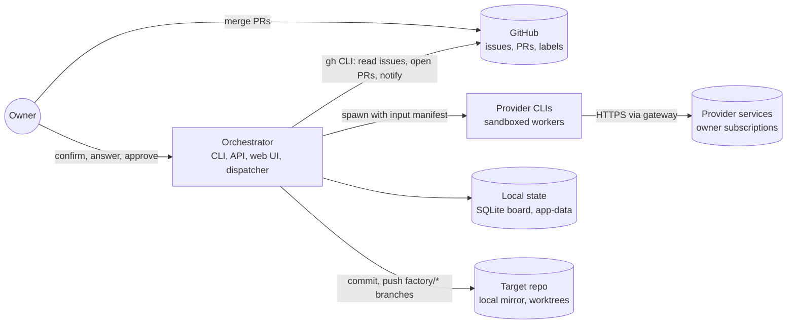
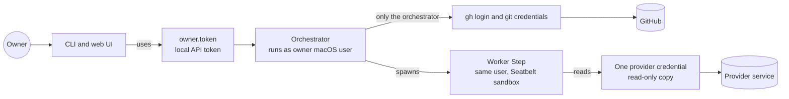
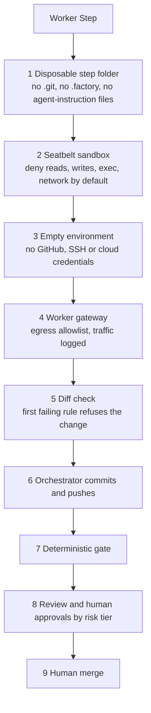
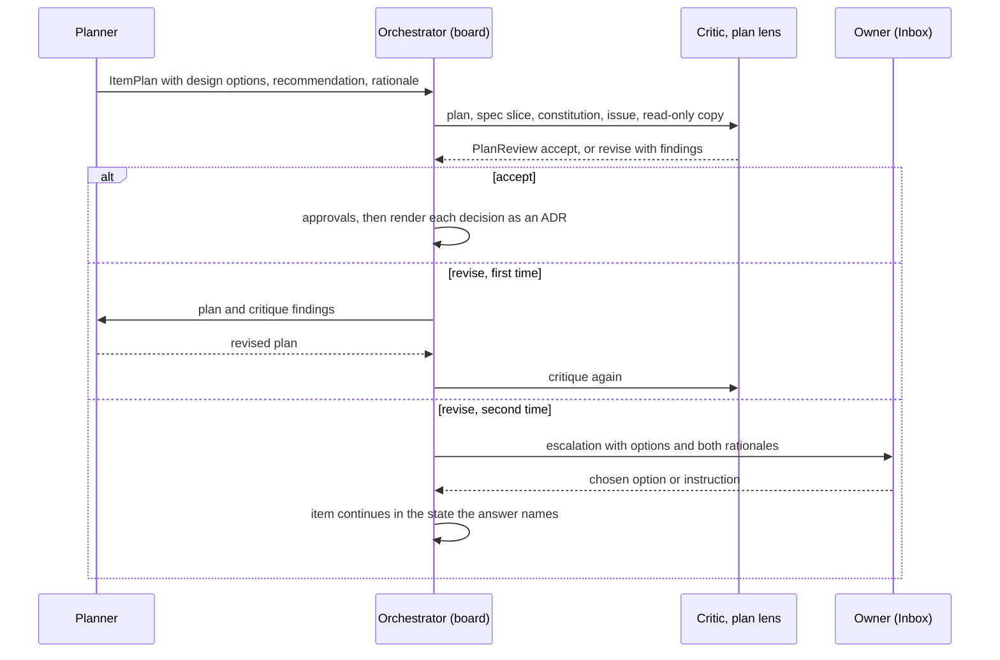
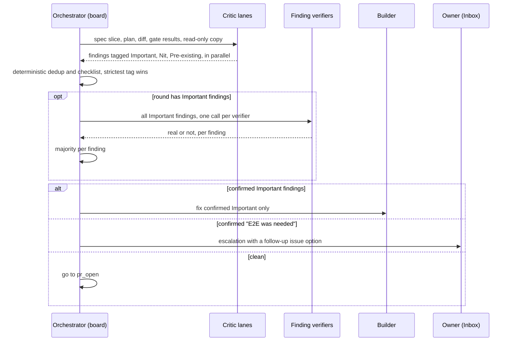
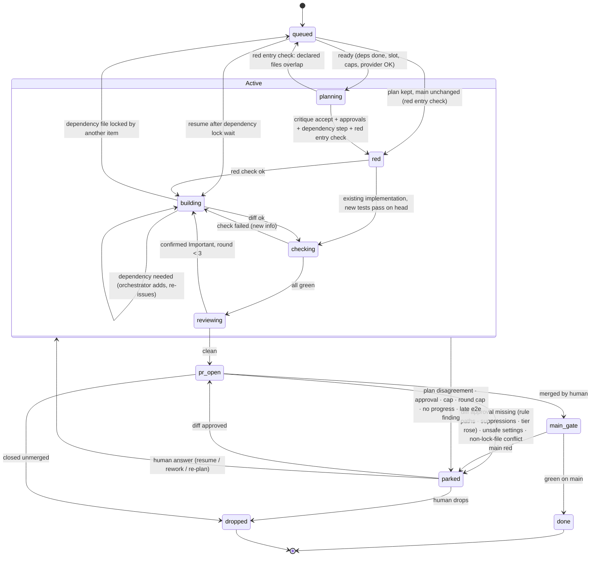
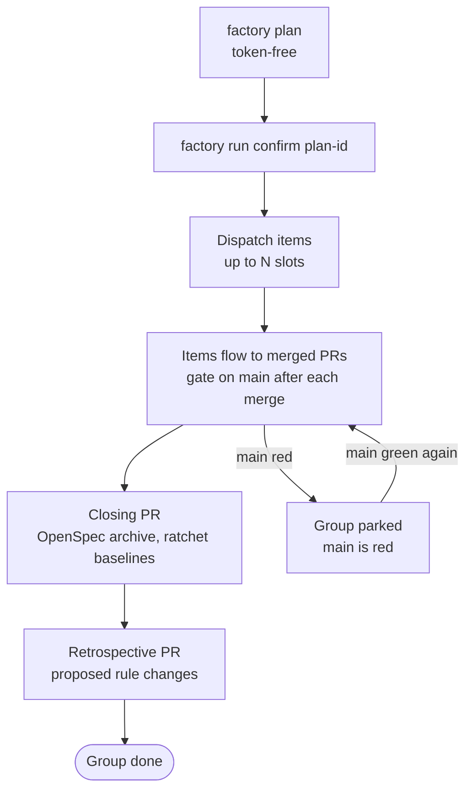
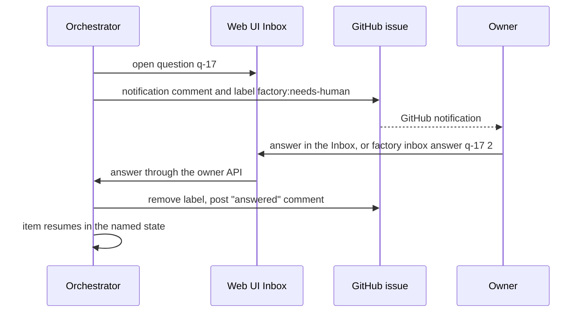
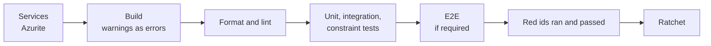

# How the Software Factory works

**Audience:** engineers who see the factory for the first time.
**Scope:** v1, as designed in [architecture/architecture.md](architecture/architecture.md) (revision 4) and the owner decisions in [decisions.md](decisions.md) up to D-72.
**Status:** the design is finished; parts of it are confirmed only in the first implementation spike. Those parts are marked "spike".

Words in **bold** on first use are glossary terms ([glossary.md](glossary.md)). Decision ids such as (D-26) point to [decisions.md](decisions.md). The body describes only v1; what comes later is listed once, in section 1.

---

## 1. What the factory is — in one minute

The **Factory** is one local .NET program on the owner's Mac. It takes a GitHub **Group** (a parent issue with sub-issues) and turns each sub-issue into one pull request (PR). A human merges every PR.

- **What goes in:** a parent issue with pre-split sub-issues, ordered by GitHub's "blocked by" links (D-05). One OpenSpec change describes the whole group (D-21). OpenSpec is a spec format with requirements written as WHEN/THEN scenarios.
- **What comes out:** one PR per sub-issue (an **Item**), a green build on `main` after each merge, the OpenSpec change archived into the live specs, and a retrospective PR with proposed rule changes (D-37).
- **Who does the work:** AI agents from three providers (Claude, Gemini, OpenAI). Each one runs as a headless command-line process (a provider CLI) under the owner's own subscription (D-04, D-57).
- **Who controls the agents:** the **Orchestrator**. It is the only part that talks to GitHub, commits, pushes and opens PRs (D-26).



### Who decides what

| Decision | Made by |
|---|---|
| What to build (issues, OpenSpec change, constitution) | The owner, before a run |
| The run plan (items, order, agent profiles, caps) | Orchestrator proposes, without calling any model; the owner confirms it by id (D-28) |
| Design choices inside the rules | The planner recommends an option; a critic checks it; on disagreement the owner decides (D-64) |
| Whether code is good enough | Deterministic checks first, then adversarial review by agents (D-13, D-29) |
| Anything the factory cannot settle, every high-risk step, every merge | The owner (D-03, D-14) |

### What v1 covers and what it deliberately does not

| Covered in v1 | Not in v1 |
|---|---|
| Input issues → merged PRs with a green `main` (D-49) | Deployment to Azure or any environment (D-49) |
| **Light mode**: agents work, a human merges every PR (D-03) | **Dark mode**: any merge without a human (D-69) |
| The owner's own greenfield repos on a personal GitHub account (D-02) | The company product (Azure DevOps, GitHub Enterprise, SLAs); a later adapter (D-02) |
| Runs on the owner's Mac (D-04) | A cloud runner (D-04) |
| Manual start from CLI or web UI (D-40) | Schedules and GitHub-event triggers (D-40) |
| CLI + local web UI (D-59) | A full terminal UI (TUI) (D-43, D-59) |

### What comes in v2

These ideas are agreed but deferred. v1's data model leaves room for them (architecture §17).

- **Council** voting across providers on design questions, with a judge and multiple rounds (D-64).
- **Holdout scenarios**: hidden acceptance checks the builder cannot see (D-67).
- Dark routes (merge without a human) and the circuit breaker that tightens autonomy (D-69).
- An eval harness that tests the factory itself on reference cases (D-69).
- Answering escalations by GitHub comment (D-70).
- Schedules and event triggers, testing a role, cloud resources via IaC (D-40, D-48).
- Another isolation method, such as a container or VM, only if needed (D-63).
- A full TUI; a cloud runner; deployment.

---

## 2. People, accounts and identities you need to configure — and why

There is exactly **one human role: the owner**. Colleagues who want a factory run their own copy with their own accounts (D-24). The factory never creates local macOS users (D-63).

### The owner

Only the owner can:

- confirm a plan by its id (D-28);
- answer an **Escalation** (a question the factory hands to a human), including a design disagreement between planner and critic (D-64);
- approve high-risk item plans, diffs that touch rule paths or add suppressions, non-allowlisted dependencies, and an `e2e` downgrade (D-14, D-50, D-52, D-65);
- merge PRs (D-03).

An approval counts only if it arrives through the owner API, which the local web UI and CLI use (D-70). Agents cannot reach that API, and nothing on GitHub is read back as an answer. So an agent approval can never count (D-14).

### Identities and where they are used



| Identity | Who or what uses it | What it can do | What it can never do |
|---|---|---|---|
| **Owner** (human) | The owner, through the local web UI or CLI; GitHub only to merge PRs and read notifications | Confirm plans, answer escalations, approve, merge | Be replaced by an agent: there is one approval path, and workers cannot reach it |
| **Owner's macOS user** | Runs `factory serve`: orchestrator, API, dispatcher, worker gateway | Read and write factory state, spawn and kill workers | Workers run as this same user, but inside a sandbox that denies the owner's home, Keychain and factory state (section 4) |
| **Claude account** | `claude -p` worker Steps | Call Anthropic's service through the Step's gateway | Be pooled or shared (D-24); reach GitHub |
| **Gemini account** | Gemini CLI worker Steps | Same as above | Same as above |
| **OpenAI account** | `codex exec` worker Steps | Same as above | Same as above |
| **GitHub login (`gh`)** and the owner's git credentials | The orchestrator only | Read issues and dependencies, push `factory/*` branches, open PRs, post notification comments, set labels | Be seen by a worker. Workers get no `GH_TOKEN`, no SSH agent, no git remote (D-26). Push protected branches or merge |
| **Local API owner token** (`owner.token`, mode 0600) | CLI commands and the browser session | Every write to the orchestrator API, including approvals | Be read by workers (the sandbox denies it); be used by other web pages (cookie `SameSite=Strict`, custom header, Origin and Host checks) |

**Why one account per provider (D-24).** The personal-use boundary: one account per provider, the owner's own work, one machine. Accounts are never pooled and the factory is never exposed as a shared service.

**Why workers never get the GitHub login.** Pushing a branch can run GitHub Actions on agent-written code. The push is the only path by which that code could act with GitHub credentials (D-50). So only the orchestrator pushes, and only after its own checks.

**Why GitHub comments are not answers.** The factory posts its comments with the owner's GitHub login. So "written by the owner's login" does not prove "written by the owner". v1 therefore reads nothing back from GitHub as an answer: the mirror is a notification only (D-70). The cost: you answer on the Mac.

**Provider credentials.** `machine.yaml` stores only the *location* of each credential, never the secret (D-15). Each Step gets a read-only copy of one credential for its own provider. How each CLI works without the macOS Keychain is a spike question (Q1). So is credential refresh (Q2).

### Repository settings that must be in place (D-50)

`doctor` refuses the repository unless all of these hold. The check runs again at `plan` and before every push.

| Setting | Required value |
|---|---|
| Default GitHub Actions workflow token | Read-only |
| "Allow GitHub Actions to create and approve pull requests" | Off |
| `main` branch | Protected |
| Secrets | Only in environments with protection rules that `factory/*` branches cannot use |

### First-run checklist

1. Install .NET, Node and the provider CLIs you want to use. `gh` must be logged in as the owner.
2. Apply the repository settings above.
3. Log in each provider: `factory provider login claude` (and `gemini`, `codex`). This runs the CLI's own login and records where the credential lives.
4. Run `factory doctor`. It checks git, `gh`, .NET, Node, Playwright browsers, Azurite, the sandbox, each provider CLI under the real sandbox profile, and the repo settings. It reports each provider as supported or `unsupported`; an unsupported provider is simply left out (D-63). No macOS users are ever created.
5. Run `factory init`, the first-run wizard. It turns free tools on, shows paid tools as off with cost notes, seeds the constitution's dependency allowlist, and adds `.github/dependabot.yml`. It shows the full config diff. Your confirmation is the SHA-bound approval for that config PR. Merge the PR.
6. Run `factory doctor --prepare` to fill the shared package caches from `main`.
7. Start `factory serve`. It prints a URL that hands the owner token to the browser once.

The order of steps 4–6 is a suggestion; the architecture does not fix it. `doctor` can be re-run at any time.

---

## 3. Default roles

A **Role** is a job an agent does. v1 has five fixed roles (D-09 as amended by D-64 and D-68).

| Role | Purpose | When it runs | Agents | Capability preset | Workspace (D-53) | Output |
|---|---|---|---|---|---|---|
| **Planner** | Drafts the item plan, including design options with a recommendation; at group close, drafts the retrospective proposal | `planning`; group close | 1 | `reviewer-readonly` | read-only copy | `ItemPlan`, `RetroProposal` |
| **Test author** | Writes failing tests first: E2E per acceptance scenario when required, plus boundary and negative-path tests (D-45, D-67) | `red` | 1 | `builder`, writes limited to test paths (D-71) | writable copy | `TestReport` + file changes |
| **Builder** | Writes the code until the tests pass; fixes confirmed findings | `building` | 1 | `builder` | writable copy | `BuildReport` + file changes |
| **Critic** | Finds defects in a plan or a diff, in a fresh context, and tags each one `Important`, `Nit` or `Pre-existing`. One lane per lens: `spec-correctness`, `security`, `architecture`, optional `simplifier`. The `plan` lens critiques every item plan (D-51) | `planning` (plan lens); `reviewing` (lanes in parallel) | 1 per lens | `reviewer-readonly` | read-only copy | `PlanReview` or `Findings[]` |
| **Finding verifier** | Votes whether each `Important` finding is real | `reviewing`, only when a round has `Important` findings (D-68) | odd: 1, 3, 5 or 7 (default 1) | `reviewer-readonly` | read-only copy | `Verdicts[]` |

Only the finding verifier takes a count. A "workspace" is a full copy of the repository at the item's head, read on demand. A readable copy is not a "repository dump": nothing is pasted into the prompt (D-53). There is no judge or moderator in v1: the review checklist is built deterministically from the critics' tags (D-68).

### Agent profiles

An **Agent profile** is a `(provider, model, effort)` triple, written like `codex/<model>/high`. Gemini CLI has no effort setting, so its effort is recorded as `n/a` and diversity comes from the model.

**Diversity rule (D-10).** When a role has more than one agent, each gets a distinct profile. A verifier never uses the builder's exact profile, and a different provider is preferred. The plan critic always uses a profile that differs from the planner's. If there are fewer distinct profiles than the count, the configuration is rejected. Reason: identical agents voting is one opinion counted several times.

**Runtime switches (D-58).** The plan lists the allowed profiles per role: a primary plus alternates. If a provider is rate-limited or near its usage threshold, the dispatcher may switch to another profile **from that list**, if the diversity rule still holds. It never switches to a profile outside the confirmed plan.

### Roles are data

Each role is one Markdown file in the target repo, `.factory/roles/<role>.md`. YAML front matter holds the data; the body holds the instructions (D-18, ADR-006):

```yaml
---
purpose: Find defects in a plan or diff against the spec, in a fresh context, read-only.
profiles: [codex/<model>/high, gemini/<model>/n-a, claude/<model>/high]
default: codex/<model>/high
lenses: [spec-correctness, security, architecture]
capabilities: reviewer-readonly
timeout: 10m
---
```

You change roles (models, effort, counts), caps and tools in the web UI's Config screen or with `factory config propose`. Both open a PR to the target repo; nothing changes until you merge it (D-72). `factory config validate` checks schema, diversity, paths and unsupported providers. A run always reads roles from the commit it started on (D-27). Providers and `machine.yaml` are machine-local and are edited directly.

---

## 4. How the factory constrains agents

The principle is "safe by structure": a prompt can be ignored, a sandbox cannot (D-17, D-26). A misbehaving worker of any provider must not be able to push, merge, change the rules or touch protected paths.



Caps and the kill switch apply across all layers.

**1. A disposable copy per Step.** A **Station** is the item's worktree (owned by the orchestrator, never seen by workers) plus one step folder per Step. The step folder `work/<step-id>/` holds an empty `home/`, the input files, an output folder and a copy of the item head. The copy excludes `.git`, `.factory/**` and agent-instruction files such as `CLAUDE.md`, `AGENTS.md`, `GEMINI.md`, `.claude/`, `.codex/`, `.gemini/`, `.mcp.json`. Each provider adapter declares its own list; the spike settles it. So a worker cannot plant instructions for a later worker. The folder is deleted after the Step.

**2. A sandbox that denies by default.** Each Step runs under its own macOS Seatbelt profile (`deny default`). It may read system paths, toolchains, read-only caches, its own folder and its own credential. It may write only its own output, `home/`, `tmp/` and, for the `builder` preset, its copy. It cannot read the owner's home, the Keychain, other Steps' folders or factory state. It cannot start code outside the sandbox (no launchd, LaunchServices or Apple Events), and it cannot signal the orchestrator. There are two presets (D-17, D-71):

| Preset | Roles | Writes | May execute |
|---|---|---|---|
| `reviewer-readonly` | planner, critic, finding verifier | output only | the CLI and read-only helpers, no shell |
| `builder` | builder, test author (test paths only) | its copy and output | shell and toolchain, offline |

**3. An empty environment.** Only an allowlist of variables is set: `PATH`, `HOME` pointing into the step folder, temp and cache locations, the proxy. No `GH_TOKEN`, `GITHUB_TOKEN`, `SSH_AUTH_SOCK` or cloud variables (D-26).

**4. A worker gateway per Step.** All network traffic goes through one localhost proxy port opened for this Step only. Worker Steps reach their provider's API hosts plus the role's web allowlist. The restore Step reaches package registries only. Other check Steps have no gateway at all. The port closes when the Step ends, so an escaped process has no network afterwards. Hosts, connections and bytes are recorded as **Telemetry** (D-66).

**5. The diff check after every worker Step.** The orchestrator compares the copy with what it handed out. The first failing rule refuses the change and the board entry names that rule:

| Rule | What it refuses |
|---|---|
| Protected paths | Any change to `.factory/**`, `openspec/**`, `docs/adr/**`, lock files or agent-instruction files (lock files are written only by the orchestrator's dependency step; a lock-file-only merge conflict is resolved by regenerating them). Only orchestrator-authored commits or human PRs change these |
| Role allowed paths | Writes outside the role's paths (the test author writes only test files) |
| Declared files | Changes to files not declared in the item plan (D-38). A new dependency in a worker's diff is not applied; it becomes a dependency request (D-65) |
| Red-test lock | The builder changing a test file the test author wrote |
| Rule paths and new suppressions | `.github/**`, gate-defining files (build props, analyzer and lint configs, `tsconfig*.json`, `package.json` scripts, `NoWarn` and similar, constraint tests), and any newly added suppression (`#pragma warning disable`, `eslint-disable`, `@ts-ignore` and similar). Rule-path changes are allowed only if declared and make the item high risk. Both need a human approval of the diff, bound to its SHA, before push (D-50) |
| Sensitive paths | Configured globs; allowed if declared; makes the item high risk |
| Hygiene | Symlinks out of the copy, stray executable bits, oversized files |

**6. Only the orchestrator commits and pushes.** Accepted changes are committed with `Factory-Step` and `Factory-Role` trailers. Only `factory/*` branches are pushed (D-26). New packages enter only through the orchestrator's dependency step, which writes the reference and the lock files itself (D-65).

**7. Configuration is read from a commit.** A run reads config, roles and the constitution from its base commit, never from the working tree (D-27). Workers get rules only through their input files. If someone changes `.factory/**` on `main` during a run, the run drains and asks for a re-plan.

**8. Caps.** In v1 a **Budget** is a simple cap (D-66). There are no reservations. Spent is computed from the recorded Steps.

| Dimension | Per item | Per run |
|---|---|---|
| `tokens` (CLI-reported, otherwise the role estimate, marked `estimated`) | yes | yes |
| `steps` (always measured) | yes | yes |
| `wall_time` (excludes `parked` and `pr_open`) | yes | no |
| `rounds` (plan revisions: 1; review rounds: 3) | yes | no |

Before each worker Step, the dispatcher checks spent plus the Step's estimate against the item and run caps. If a cap would be exceeded, the Step does not start, and the refusal names the cap, for example `cap item#42.tokens: limit 1.5M, spent 1.31M (est.), next step est. 0.25M`. A limit stops new work, not calls already running (D-28). With N slots, an overshoot is at most one in-flight Step per slot. An item cap escalates; a run cap drains the run.

**9. The deterministic gate.** Build, lint, tests and constraint rules run before any model reviews the code (D-29). See section 10.

**10. Human approvals by risk tier.** The **Risk tier** is set by the change, not by the author (D-14):

| Tier | Set when | Human touches |
|---|---|---|
| low | all changed paths match `low_risk` globs | merge |
| medium | default | merge |
| high | rule path, sensitive path, dependency manifest, or more than `max_files` files | all critic lenses; plan approval before `red`; merge |

Independent of tier: non-allowlisted dependencies need the owner's approval (D-65), and a diff that touches rule paths or adds suppressions needs a SHA-bound diff approval before push. Every approval binds a SHA or hash. If the object changes, the approval is void.

**11. Kill switch.** `factory kill` kills all worker processes, closes all gateway ports and marks runs `killed`. Nothing writes to GitHub afterwards. `run resume` continues from stored state.

### Known limits the spike must settle

The architecture is explicit that these are not yet proven:

- **Credentials without Keychain (Q1).** Claude stores its login in the Keychain on macOS. If a CLI cannot run with a file or token credential, that provider is `unsupported` and the factory runs with the others (D-63). No local users are created.
- **Mach-service allowlist (Q1).** It must be narrow enough to exclude launchd, LaunchServices and Apple Events. If not, that provider is `unsupported`.
- **CLIs inside the outer sandbox (Q3).** Each CLI's own sandbox is turned off because sandboxes cannot nest. Proxy compliance, flags, working without a shell, and each CLI's list of instruction files must be verified. `sandbox-exec` is deprecated by Apple. A CLI that cannot work this way is `unsupported`, never run unsandboxed.
- **Escaped processes (Q4).** Double-forked processes may leave the process group. Mitigations: per-second PID tracking, a marker scan, and the gateway port closing. If that is not enough, the CLI is `unsupported`.
- **Provider use from shells (D-60, D-66).** For builder and test-author Steps, the sandbox cannot tell the CLI's own connections from those of its shell commands. Provider traffic beyond what the CLI reports is flagged on the board and on Health. It is not blocked and not charged. The exposure is quota, not safety.
- **Subscription usage (Q5).** Claude and Codex CLIs may not expose remaining quota. Then usage is "not measured" and the 80% usage threshold cannot apply; a `rate_limited` failure is the hard signal.
- **Exact CLI flags** for headless mode, JSON output, effort and usage are marked "verify" in the architecture.

---

## 5. How sessions from different providers communicate

They never talk to each other directly (D-11). Every exchange goes through the orchestrator's **Board**: an append-only SQLite table of everything that happened. Rows are never updated or deleted.

- **Roles are addressees.** A task is addressed to a role, not to a specific agent (D-08). The orchestrator picks a profile from the plan's list and records `task.addressed`, then `task.delivered` or `task.failed`.
- **Input manifests.** An **Input manifest** is the exact list of what a worker receives (D-30): role instructions and constitution, a spec slice, the item plan, a diff, gate results, a checklist, a failure report, the owner's answer, a dependency that was added. Each entry carries a hash. A worker never receives another worker's reasoning or transcript.
- **Typed outputs.** Every worker writes `io/out/result.json`, validated against the role's JSON Schema. The common envelope has `status: done | blocked | needs_context`.
- **`needs_context`.** This is the only context mechanism in v1. A worker that needs more input stops with `status: needs_context` and says what it needs. Its file edits are discarded. The orchestrator fetches the input, logs `context.fetched`, and re-runs the Step with the larger manifest. There is no live tool server in v1.
- **Dependencies are not context.** A builder that needs an undeclared package ends with `blocked: dependency`. Its edits are discarded. The orchestrator runs the dependency step (asking the owner only for a package not on the allowlist), then re-runs the builder with `dependency-added` in its manifest. The item does not go back to planning (D-65).

So in v1, providers meet only in two places: the plan critique (a different profile from the planner's) and the review (critics and verifiers that differ from the builder's profile).

### A design question in v1

There is no council in v1 (D-64). Design options live in the item plan. The plan critique is the second opinion. If the two still disagree, the owner decides.



Each decided design question becomes an ADR (architecture decision record) at `docs/adr/i<issue>-<n>-<slug>.md` on the item branch. The orchestrator renders it without a model call.

### One review round

One round is one visit to `reviewing` (D-13 as amended by D-68). Critics favour false positives; the verifier removes them.



- From round 2, critics get only the diff since the last review and the summaries of earlier findings.
- A lane or verifier that does not answer leaves the round **incomplete, never clean** (D-29). It gets one retry with another profile from the plan, then escalates.
- The builder may dispute a finding as intentional; the next round's verifier decides.
- Nits go to the PR body (at most 3). Pre-existing findings become follow-up issues.
- A late "E2E was needed" finding is not sent to the builder, who must not write tests for its own code. It becomes an escalation (D-71).
- After round 3 the item is escalated.

---

## 6. The life of one item

An item has eleven states, stored in SQLite. Every transition and its board entry are written in one transaction. Every Step is idempotent, so the factory can crash and resume (P5).



### Walkthrough: from issue to merged PR

1. **`queued`.** The item waits until its blockers are `done`, a slot is free, the run caps are not reached, and its providers are below the usage threshold.
2. **`planning`.** The planner writes the item plan: approach, design options with a recommendation, declared files, declared dependencies, red tests (including boundary and negative-path tests), the E2E decision, risk tier, complexity and the OpenSpec requirements it covers. Then one critic with the `plan` lens reviews all of it: `accept` or `revise` (D-51). One revision is allowed; a second `revise` parks the item for the owner (D-64).
3. **Approvals.** All approvals that apply form **one** question to the owner: a high-risk plan, an `e2e` downgrade from `required` to `not-applicable`, declared dependencies not on the allowlist. Then the orchestrator renders the design decisions as ADRs.
4. **Dependency step.** For declared dependencies, the orchestrator writes the package references and lock files and restores packages into an item-local folder. No model is involved (D-65).
5. **Red entry check.** Atomic: the declared files must not overlap a locked item, the file lock is taken, and any approval must match the current plan hash and base commit. On overlap the item goes back to `queued` with its plan kept.
6. **`red`.** The test author writes failing tests first. If `e2e: required`, that includes at least one E2E test per acceptance scenario (D-45). It also writes boundary and negative-path tests per requirement (D-67). The red check confirms the new tests fail and existing tests pass. The test ids are recorded and the test files are locked.
7. **`building`.** The builder implements in its writable copy. The diff check runs. If the builder needs a new package, the dependency step runs inside `building` and the builder is re-run; a non-allowlisted package parks the item for the owner first.
8. **`checking`.** The deterministic gate runs offline (section 10). Failure sends the item back to `building` with a failure report. The same failure twice parks it.
9. **`reviewing`.** Critic lanes, deterministic checklist, verifier on `Important` findings (section 5).
10. **`pr_open`.** The orchestrator re-checks the repo settings and checks any required diff approval. Then it pushes and opens the PR. The PR body has the plan, ADRs, gate results, review ledger and cost. If `main` moves, it merges `main` into the branch and re-runs the checks.
11. **`main_gate`.** After the owner merges, the gate runs on `main` at the merge commit. Green → `done`.

**Parked and escalation paths.** Any active state can go to `parked`: plan disagreement, an approval, a cap, the review round cap, no progress, a late E2E finding. A parked item releases its slot but keeps its file lock. The owner's answer names the next state: resume, rework (`building`), re-plan (`planning`) or drop (`dropped`).

**Slots and locks.** A slot is held from `planning` to `reviewing` (default 2 per machine, D-38). The declared-file lock is held from `red` until `done` or `dropped`, so two open PRs never touch the same files.

---

## 7. The life of a group and a run

A **run** carries out one confirmed **Plan (of a run)**. A **group** takes one parent issue to "done". Group states: `new → active → closing → done`, plus `parked`.



1. **Plan (D-28).** `factory plan --group <issue>` (or `--milestone <m>`). No model is called. The orchestrator re-checks the repo settings, reads config from the base commit, reads issues and dependencies, and loads the OpenSpec change. It computes: item order, allowed profiles per role, gates, caps, a default E2E decision per item, and a cost estimate. It prints the plan id, which is a hash of base commit, config and plan body.
2. **Confirm.** `factory run confirm <plan-id>`. It refuses if `main` or the config moved since the plan (exit 5, re-plan) or if the estimate exceeds a run cap (exit 4, the cap is named).
3. **Dispatch.** Ready items start, up to `slots` at a time. The group becomes `active` with its first item.
4. **Closing.** When all items are `done`, the orchestrator opens the **closing PR**. It archives the OpenSpec change deterministically and writes the tightened ratchet baselines.
5. **Retrospective.** The planner, with retrospective instructions, proposes edits to role instructions, the constitution and review notes. Its input is the group's journal, review ledger, finding outcomes and escalations. This PR is high risk and needs the owner.
6. **Group done** when the closing PR is merged, `main` is green and the retrospective PR is open (D-37).

If `main` turns red, the group parks, its dispatch pauses and the owner gets an escalation; other groups continue.

**Run states:** `planned → running → draining → stopped | done | killed`.

- `run stop` drains: no new Steps start, running Steps finish their current Step, then the run stops. `run resume` continues on the same snapshot. A run-cap overrun also drains.
- **Re-plan:** a new run adopts the unfinished items. Items in `pr_open` or `main_gate` continue as they are. All others go back to `planning` with their plan kept as a draft; the critique and approvals run again.
- A **dry run** (`--dry-run`) records worker Steps as skipped, runs the gates on the base commit, and only logs "would write" for GitHub. It spends zero tokens.

---

## 8. When the factory asks you

An **Escalation** is a question addressed to the owner (D-20). The item parks; other items and groups continue.

| Kind | Reasons |
|---|---|
| Undecided | Planner and plan critic disagree (second `revise`); review round cap reached; a late "E2E was needed" finding |
| Limits | Item cap reached; no progress (same failure twice); repeated flakiness; repeated diff violations |
| Approvals | The plan's approval question (high risk, `e2e` downgrade, non-allowlisted dependencies); a non-allowlisted dependency during `building`; a diff with rule-path changes or new suppressions |
| Environment | Unsafe repo settings at push; `main` is red; config changed on `main` (notice only) |

**Format ("grill").** Question id, the question, numbered options, a recommendation, and evidence links (board entries, PR, gate logs).



**Where to answer — only on the Mac (D-70):**
- the Inbox screen in the web UI;
- `factory inbox answer q-17 2` or `factory inbox answer q-17 --text "..."`.

**The GitHub mirror is a notification only.** It is a comment on the item's issue (the group issue for group-level questions) with a hidden marker, the question, the options and the command to answer. It also sets the label `factory:needs-human`. Agent text in it is block-quoted. Nothing on GitHub is read back. An optional macOS notification can be turned on in `machine.yaml`.

**While waiting:** the parked item holds no slot but keeps its file lock. Independent items keep running. Wall time does not count while parked.

---

## 9. Where things live

There are two places: the **target repo** (human-reviewed only) and **machine-local state** (D-35).

**Target repo** — everything here is reviewed by a human through a PR:

```
<target-repo>/
├─ .factory/
│  ├─ factory.yaml        # optional; missing = defaults
│  ├─ constitution.md     # stack, principles, allowed/forbidden choices, E2E tooling, dependency allowlist
│  ├─ ratchet.yaml        # metric baselines, tightened only in the closing PR
│  └─ roles/              # planner, test-author, builder, critic, finding-verifier
├─ openspec/              # specs and changes
├─ docs/adr/              # i<issue>-<n>-<slug>.md, rendered by the orchestrator from plan decisions
├─ tests/                 # incl. constraint tests (a rule path)
├─ packages.lock.json, web/package-lock.json   # written only by the orchestrator's dependency step
├─ CLAUDE.md, AGENTS.md, .mcp.json, …          # protected; never copied to workers
└─ .github/               # rule path; dependabot.yml added by init
```

**Machine-local** — `~/Library/Application Support/afactory/`, never committed:

```
afactory/
├─ machine.yaml           # provider registry (credential locations), slots, ports, notifications, provider window limits
├─ factory.db             # SQLite: state tables + board
├─ owner.token            # API token, mode 0600
├─ caches/                # shared package caches, filled only from main, read-only to Steps
├─ repos/<owner>__<repo>/
│  ├─ mirror.git
│  ├─ items/<issue>/{worktree, packages/}
│  └─ runs/<run-id>/{plan.json, config-snapshot/}
├─ work/<step-id>/        # step folders, deleted after each Step
└─ transcripts/<step-id>.jsonl
```

Changes to `.factory/**` go through a PR: your own, or one the Config screen or `config propose` opens (D-72). Configuration files are YAML validated by a JSON Schema (ADR-006).

---

## 10. Quality gates and tests

A **Gate** blocks progress until it passes. The gate is deterministic, runs offline, and runs before any model review (D-29). Each check is a check Step in the sandbox with no credentials and no provider hosts. Packages were restored earlier by the dependency step; `checking` does not restore.



**Rules:**
- A check that could not run is a failure. "Not measured" is never 0 (D-29).
- Commands come from the config snapshot and call tools directly, not repo scripts.
- The gate runs for each item in `checking`, again in `pr_open` when `main` moves, on `main` after every merge, and on `main` after foreign commits such as Dependabot merges.
- The diff check (section 4) runs after every worker Step and is separate from the gate.

**Ratchet.** A **Ratchet** keeps a metric from getting worse. Metrics: warnings, analyzer findings, test count, coverage if configured. The baseline is the stricter of `.factory/ratchet.yaml` and the best value measured on `main` during the group. The file is updated only in the closing PR. Suppressions are not a ratchet metric: any new suppression in a diff needs a SHA-bound human approval instead (section 4).

**E2E decision and red step (D-44, D-45, D-52, D-71).**
1. The plan preview shows a default (`required` unless the item is labelled internal, docs or config). The owner can pin it.
2. The planner may change an unpinned value with a reason. `required → not-applicable` needs the owner's confirmation in the plan's approval question; the reverse only posts a notice.
3. The plan critique checks every `not-applicable` reason.
4. In `red`, the test author writes at least one E2E test per acceptance scenario, traced by OpenSpec scenario id.
5. If the review's spec lens finds late that E2E was needed, the item escalates with a follow-up-issue option.

**Boundary and negative-path tests (D-67).** In v1 there are no hidden holdout tests. Instead, the test author must write visible boundary and negative-path tests for each requirement. The plan critique checks they are planned; the `spec-correctness` lens checks them in review.

**Flaky tests (D-47).** A test that fails and then passes on its one retry is marked `flaky` on the board and does not fail the gate. The same test flaky on 3 items escalates. No automatic quarantine in v1.

**Free vs paid tooling (D-23, D-41).**

| On by default (free) | Off by default (offered with cost notes) |
|---|---|
| ESLint + Prettier; `dotnet format`; Roslyn analyzers as errors | SonarQube Cloud (free up to 50k LOC private) |
| xUnit + `WebApplicationFactory`; Playwright Test (D-46) | CodeQL and secret scanning (paid for private repos) |
| Azurite as a local npm process, no Docker | Real Azure resources |
| Dependabot; ratchet and journal | |

When enabled, the paid tools are telemetry in v1 (measured and shown, never blocking), not gates.

---

## 11. Watching and steering it

The CLI is the base surface; the web UI is the interactive surface. Both use the same API, and every UI action has a CLI command (D-31, D-59).

### CLI at a glance

| Command | What it does |
|---|---|
| `factory serve` | Start the orchestrator (dispatcher, API, web UI, gateway) |
| `factory doctor [--prepare]` | Check the environment and repo settings; `--prepare` fills caches |
| `factory init` | First-run wizard |
| `factory plan --group <n> [--dry-run] [--cap k=v]` | Build the token-free plan |
| `factory run confirm <plan-id>` | Start exactly that plan |
| `factory run status [--watch]` | Run, items, slots, next actions |
| `factory run stop` / `run resume` | Drain and stop / continue |
| `factory kill` | Kill switch |
| `factory item show <id>` | State, plan, steps, questions, findings, cost, PR |
| `factory inbox list` / `inbox answer` | Escalations and approvals; the only way to answer besides the UI |
| `factory board tail` | Live board entries |
| `factory cost` / `factory health` | Spend; "needs a look" |
| `factory config validate` / `config propose` | Check config at a commit / open a config PR |
| `factory machine show \| set k=v` | Read or change `machine.yaml` |
| `factory provider list \| probe \| login` | Provider registry |

Full list: architecture §13.

**`--json`.** With `--json` (or when output is redirected), stdout carries one JSON document. Logs go to stderr. Live views emit one document per line (NDJSON).

```json
{"schema":"factory.cli/v1","ok":true,"kind":"run","data":{},"refusal":null,
 "next_action":{"actor":"human","command":"factory inbox answer q-17 2","reason":"plan disagreement on q-17"}}
```

**`next_action`.** Every state document says who acts next (`human`, `factory` or `none`) and with which command.

**Exit codes (stable):**

| Code | Meaning |
|---|---|
| 0 | Success (a human may still be needed; see `next_action`) |
| 1 | Internal error |
| 2 | Invalid usage or config |
| 3 | Environment not ready (doctor failed, unsafe repo settings, server not running) |
| 4 | Refused by a cap or policy |
| 5 | Conflict or stale (e.g. plan stale) |
| 6 | Not found |
| 7 | Completed with failures |
| 130 | Interrupted |

**Live terminal views.** `factory board tail` and `factory run status --watch` render live tables in the terminal from the same event stream the UI uses.

### The five web UI screens (D-42)

| Screen | Use it to |
|---|---|
| **Runs** | Preview a plan (items, order, roles, allowed profiles, gates, caps, estimate, E2E pins), confirm it, watch the live board per item, read plans with their design options, plan critiques and review ledgers |
| **Inbox** | Answer escalations and approvals; rule-path and suppression approvals include a diff view |
| **Config** | Edit roles (models, effort, counts), caps and tools as a PR to the repo; edit providers and `machine.yaml` directly (D-72) |
| **Health** | "Needs a look": failures by role and failure class, stuck or parked items, slots, provider usage, flagged gateway traffic, flaky tests |
| **Cost** | Spend per run, group, role and provider; estimate vs actual; finding outcomes; daily tasks and failure rate |

The UI listens on `127.0.0.1` only. Agent-written text is shown as sanitised Markdown without raw HTML.

### Cost and health

With default counts (3 critic lenses, 1 verifier), an item takes about this many model calls:

| Case | Calls |
|---|---|
| Clean item, no `Important` finding | 7 |
| One `Important` finding, rejected by the verifier | 8 |
| One fix round | 12 |
| Worst case (7 verifiers, 4 lenses, 3 rounds, plan revised, red retried) | ≈ 42 |

- Subscription use is shown as tokens and steps. Dollars appear only as "API-equivalent", where a CLI reports it.
- Missing data is shown as "no data" with a reason, never as 0. Totals over partial data show "≥ X (n of m measured)".
- The plan's estimate starts from built-in defaults and is recalibrated from the journal (the board's measurement entries) after each group (P12).
- Quality signals in v1 come from the journal: tokens per verified outcome, review rounds, escalations, finding outcomes and flaky tests. The retrospective PR uses them.

---

## 12. Glossary and further reading

- [glossary.md](glossary.md) — shared vocabulary used in this document. Some entries describe v2: **Council**, **Judge / moderator**, **Holdout scenarios** and **Dark mode**. In v1 a **Budget** is a cap per item and run (D-66).
- [values.md](values.md) — the five values in priority order that decide every trade-off.
- [requirements.md](requirements.md) — what the owner asked for (R1–R13) and what was proposed (P1–P20).
- [decisions.md](decisions.md) — owner decisions D-01…D-72 with reasons (D-01 is superseded by D-25, D-61 by D-63).
- [architecture/architecture.md](architecture/architecture.md) — the full v1 architecture, revision 4; §17 lists everything deferred to v2.
- [architecture/adr/](architecture/adr/) — architecture decision records ADR-001…ADR-007.
