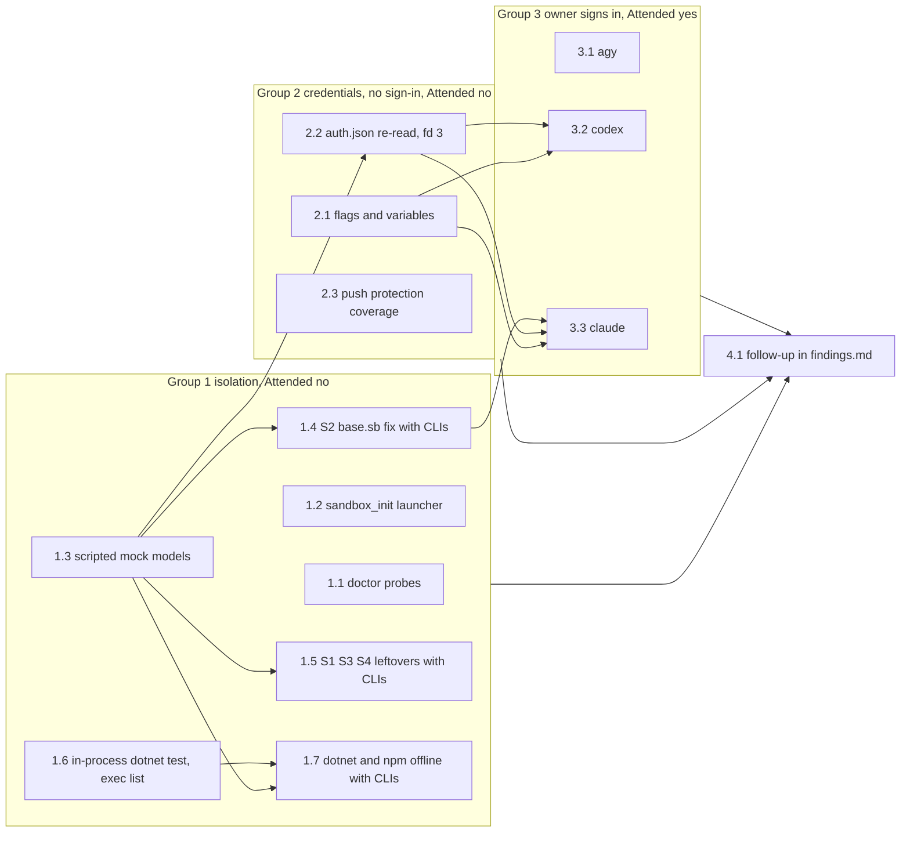

# Design

## Context

This change continues M0 after `spike-sandbox-and-providers` was archived. Scope and pass criteria come from [docs/spike/plan.md](../../../docs/spike/plan.md) (E1–E12, S1–S7, exit criterion 4) and from the open items in [docs/spike/findings.md](../../../docs/spike/findings.md) (§6 S1–S7, §8 exit criteria, §9 owner questions); the per-task evidence is in [docs/spike/findings/](../../../docs/spike/findings/). This document only fixes how the work is cut into sessions and how results are kept. Binding references: D-24, D-56, D-57, D-63, [ADR-004](../../../docs/architecture/adr/ADR-004-provider-adapter-file-based-typed-io.md), [ADR-005](../../../docs/architecture/adr/ADR-005-station-isolation-on-macos.md), architecture [§4](../../../docs/architecture/architecture.md#4-provider-adapter-contract), [§5](../../../docs/architecture/architecture.md#5-station-and-sandbox), [§19](../../../docs/architecture/architecture.md#19-open-questions-and-risks-top-10-each-with-a-proposed-default), and the proposed entries D-75..D-83 in [docs/decisions.md](../../../docs/decisions.md) (the owner's current stance on them is in the proposal, "Impact").

## Goals / Non-Goals

**Goals:**
- Each check ends with a recorded measurement (command, version, profile, outcome, a log excerpt) that a later session can re-run.
- Work is cut into one-session tasks. A task is either `Attended: no` or `Attended: yes`, never both.
- The follow-up section of `findings.md` and the input list for later `D-NN` entries are ready for a `decide` session.

**Non-Goals:**
- Production code, an adapter, `doctor` itself, or any change to `spike/harness/**`, the architecture or `docs/decisions.md`.
- Choosing between options. Where a result decides the choice, the findings state the result and the options, and the choice is the owner's (examples: `agy` has no standard way to get a fresh token; the in-process `dotnet test` runner does not work for the sample project; push protection covers a pattern the factory also wanted to filter).
- Checks the owner did not list. Two items from the proposed decisions are **not** in this change and are flagged in the PR handoff: the D-77 verification of the narrow `reviewer-readonly` exec list on real codex and `agy` (`rg` location, `git` shim, hostile probes), and the D-80 §2 probe for a narrower pseudo-terminal rule. The Gemini CLI is not exercised (D-78).

## Decisions

1. **Isolation first, credentials second, attended last.** Group 1 needs no provider credential, group 2 needs none and only runs provider binaries in ways that make no model call, group 3 needs the owner. Attended tasks are listed last so `scripts/next-task.sh` selects them last (D-74 §1) and the session asks the owner first.
2. **A scripted mock model removes the need for a credential in group 1.** The spike's mocks for claude and codex only return errors; only `agy` has a mock with scripted tool calls (`spike/gemini/mock-api.mjs`). Task 1.3 builds the same kind of throwaway mock for the Anthropic and Responses APIs, so a real CLI binary runs its real tool shell under the profile without quota or sign-in. A mock proves what the sandbox does to the CLI's tool shell, not that the provider accepts a credential. **If a mock cannot drive a CLI's tool shell, the affected check is recorded as "not shown without a real model" and is repeated inside an attended task; the findings state which.**
3. **Candidates live in the task's own directory.** A changed profile (the S2 `base.sb` fix, an extended builder exec list, a loopback rule for check Steps) is copied under `spike/followup/<task>/` and measured there. `spike/harness/**` is not edited (it belongs to the archived change). This keeps declared files disjoint, so sessions can run in parallel (D-38, D-73).
4. **One findings file per task, one writer for the consolidation.** Each task writes `docs/spike/findings/followup-<name>.md` and `spike/followup/<name>/`. Only task 4.1 touches `docs/spike/findings.md`, and only by appending a "follow-up" section; the earlier text is not edited.
5. **Evidence hygiene (public repository).** Committed logs are excerpts: hosts, counts, denials, exit codes, never tokens, request bodies or home-directory paths (`<step>/…`, `<factory-dir>/…`). Raw logs and credential copies stay in git-ignored `spike/work/`. This rule carries over from the archived change.
6. **Credentials and the owner's machine (attended tasks).**
   - The owner signs in to a **dedicated factory directory** outside the repository, with a separate account where one exists (D-75 §3). Nothing is copied from the owner's own login, and the Keychain is neither enumerated nor read nor written by the session. Where a test could write to the owner's login Keychain (task 3.1 question on token file versus Keychain), the session first asks the owner whether that is acceptable; if not, the check is recorded as "not verified".
   - A secret or sign-in code is requested only through the secret-request tool, one value per request, never through chat. A script run on the owner's machine reads the factory file itself; the session never prints it.
   - Provider CLIs run inside the spike's Seatbelt profile with an empty adapter-owned `HOME`, except the sign-in command itself, which runs plainly outside the sandbox because that is what D-75 §1 prescribes and what the check is about. No provider CLI runs with the owner's real `HOME` outside Seatbelt without the owner's consent.
   - Real model calls are tiny fixed prompts, one run per cell (value 1).
7. **No model, no credential for groups 1 and 2.** CLI help, version and feature listings run under the profile with an empty `HOME`; mock servers answer on `127.0.0.1`; credential files in these tasks are fabricated (dummy JWT-shaped tokens, dummy `CODEX_HOME`).
8. **The result decides, the owner chooses.** Every task whose outcome can select between options ends the findings entry with "Result" and "Options (owner's choice)". No task text pre-selects an option; the options named in the owner's decisions (D-75, D-80 §3) are only named as the things to measure, in the owner's stated order.
9. **Task 4.1 maps results to decisions, it does not write them.** The follow-up section lists, per proposed entry (D-75, D-77, D-78 §3, D-79, D-80, D-81, D-82, D-83), which result confirms, contradicts or leaves open its "Not verified" items, as input for a `decide` session.

## Risks / Trade-offs

- **A scripted mock may not drive a CLI's tool shell** (the CLI may reject the mock's response shape). Mitigation: decision 2, fallback recorded in the findings and repeated in an attended task. Cost: task 1.3 may end with only a partial mock.
- **Subscription quota and account risk** in attended tasks: tiny fixed prompts, a separate account, one run per cell. The agy login made in the archived spike was never revoked at Google (findings §9 (h) 3); the owner revokes the factory sign-ins after group 3 if they wish.
- **A flag found in `--help` may not work** (listed but ignored). Task 2.1 therefore records "listed" and "observed" separately; only an observed effect is a fact.
- **A scripted mock on `127.0.0.1` needs loopback rules** in the profile, as in the archived mock runs; a rule added only for the mock must be named as such and is never carried into a candidate profile for the product.
- **Candidate profiles measured only with a mock** may differ from real runs: the findings state which CLI behaviors were shown and which were not.
- **`sandbox-exec` is deprecated.** Task 1.2 is a measurement of a fallback, not an adoption; whether to adopt it is the owner's call.
- **Attended tasks block on the owner's availability.** They are independent of each other except for the listed `blocked by` notes, so one can be done in any order once its blockers close.
